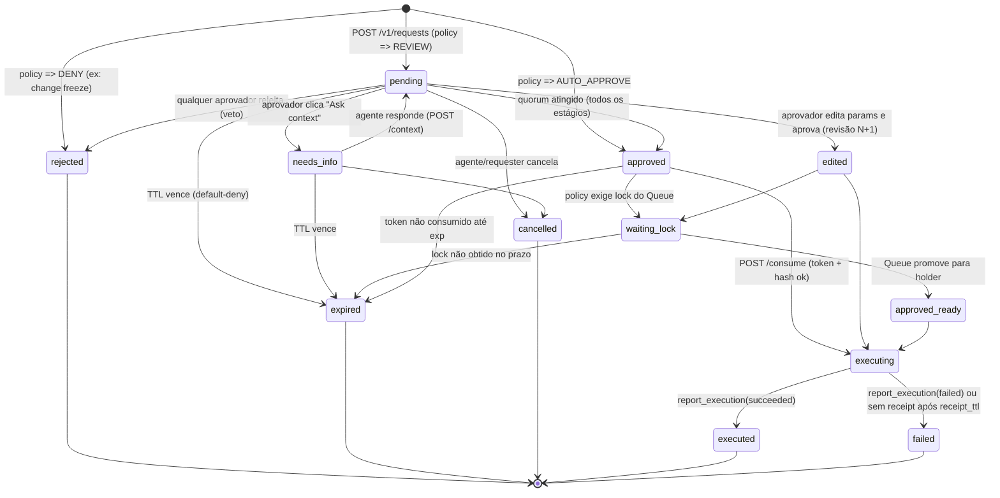
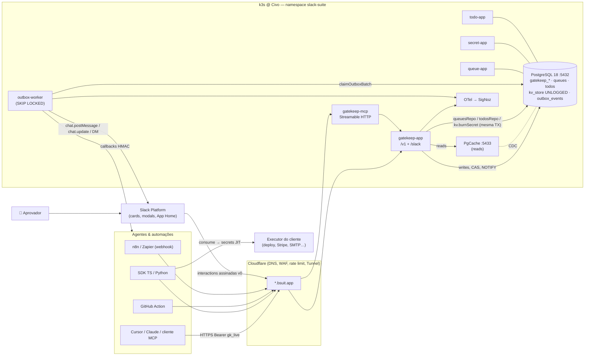

# PRD + Design Técnico — **Gatekeep** (bsuit.app)

**Autor:** Grok Bot (executor) para Leonardo Benedet (solo, Brasil)  
**Data:** 14 out 2026 (America/Sao_Paulo)  
**Status:** Draft / Discovery → pronto para MVP de 3 semanas  
**Repo:** `BenedetLabsBots` (Deno 2.9 monorepo · PostgreSQL 18 · PgCache · outbox worker · Slack Block Kit · Cloudflare Tunnel `*.bsuit.app` · k3s/Civo · SigNoz)  
**Idioma do produto:** English (US) na UI do Slack, como as demais apps; este documento está em pt-BR.  
**Filosofia herdada do PRD1:** native-first, zero context-switching, ack < 300 ms, PLG, escopos mínimos.

> Convenções: **[HIPÓTESE]** = suposição não validada. **[FATO]** = verificado em fonte citada ou no código do repo. Não há números de mercado inventados; onde faltar dado, está escrito "sem dado".

---

## 0. TL;DR (o "elo" em uma página)

**Gatekeep é a camada de aprovação humana (human-in-the-loop) para agentes de IA e automações, que vive no Slack.** Antes de uma ação de risco (deploy, migration, refund, e-mail externo, mudança de infra), o agente chama o Gatekeep; aparece um card de aprovação no Slack com ação, parâmetros, risco e diff/dry-run; um humano clica **Approve / Reject / Edit params / Ask context**; o agente recebe a decisão (long-poll ou webhook); timeout = **negado por padrão**; tudo fica auditado.

O pitch anterior era fraco porque não mostrava **como as peças se conectam**. Este plano torna explícitos os dois elos:

**Elo (a) — Agente ↔ Gatekeep ↔ Slack:**

1. **Superfícies:** REST API · SDK TS · SDK Python · **MCP server** (`request_approval`, `get_approval_status`, `report_execution`…) para Cursor/Claude/qualquer cliente MCP **sem código** · GitHub Action · nó n8n · webhook genérico (Zapier/Make).
2. **Contrato:** máquina de estados formal (`pending → approved | edited | rejected | needs_info | expired | cancelled → executing → executed | failed`), `Idempotency-Key`, callbacks assinados com HMAC.
3. **Binding criptográfico:** a aprovação é sobre um **hash SHA-256 do payload canônico (RFC 8785/JCS)**. O agente recebe um *approval token* de uso único amarrado a esse hash; para executar, apresenta token + hash, e o Gatekeep (ou o SDK, ou o executor) recusa se o que vai rodar ≠ o que foi aprovado.
4. **Loop fechado:** o agente reporta o resultado (`report_execution`) e o **mesmo card no Slack** é atualizado para ✅ Executed / ❌ Failed, com link de log.

**Elo (b) — Gatekeep ↔ suíte bsuit:**

1. **Secret = a fechadura.** Sem Secret, o Gatekeep é só um semáforo (o agente pode ignorar). Com **just-in-time secrets**, a credencial necessária para a ação só é liberada (1 leitura, TTL curto, amarrada ao hash) **depois** da aprovação. O gate passa a ser *duro*.
2. **Queue = a ordem.** Deploys aprovados entram na fila/lock do recurso (`queuesRepo.joinQueue`); o token só é liberado quando o pedido vira holder do lock; quem detém o lock pode vetar; ao reportar execução, o lock é liberado (`queuesRepo.releaseLock`).
3. **Todo = o follow-through.** Reject com motivo, "needs info" e execução falha viram tarefas (`todosRepo.create`) com permalink para o card.
4. **Plataforma compartilhada:** `workspaces`/`workspace_installations` (app_slug `gatekeep`), `mauRepo`, `@suite/billing`, `@suite/outbox` (`enqueueOutboxEvent`, `cancelOutboxEvents`), `@suite/crypto`, `@suite/slack-kit` (`verifySlackSignature`, `slackApi`).
5. **Reposicionamento:** bsuit deixa de ser "3 micro-utilities" e passa a ser **"o control plane de agentes de IA e ops dentro do Slack"**: *Gatekeep decide · Secret entrega a chave · Queue ordena · Todo garante o follow-up.*

---

## 1. Problema e evidências

### 1.1 Problema

Times estão dando a agentes (Claude Code, Cursor, agentes internos em LangGraph/n8n, scripts de CI) permissão para **escrever no mundo real**: deploy, `ALTER TABLE`, refund no Stripe, e-mail para cliente, `terraform apply`. Hoje há três opções ruins:

1. **Dar permissão total** e torcer (o agente faz no 1º call o que deveria ser revisado).
2. **Não dar permissão** e transformar o humano em copy-paster do agente (perde o valor da automação).
3. **Construir aprovação caseira**: um `chat.postMessage` com botões + um webhook + estado em algum lugar. Quebra em: timeout, quem pode aprovar, aprovação de parâmetros diferentes do que rodou, auditoria, retries, idempotência.

O problema de fundo não é "falta botão Approve no Slack" (isso já existe em vários lugares). É **falta de um contrato confiável entre "o que o humano aprovou" e "o que a máquina executou"**, com política, credencial e fila no meio.

### 1.2 Sinais (apenas sinais, não prova de mercado)

Posts lidos via API do X em 14 out 2026. Engajamento baixo — **servem como indício do vocabulário/padrão que a comunidade está convergindo, não como validação de demanda**.

| Post | Data (BRT) | O que diz | Leitura |
|---|---|---|---|
| [x.com/i/status/2104626295480938520](https://x.com/i/status/2104626295480938520) (@grok, resposta a @n8n_io) | 28 set 2026 | "Mark the on-call paging tool or workflow as requiring approval. The agent pauses before calling it, shows the exact parameters via Slack… only runs after human Approve/Reject. Keep it gated for irreversible high-stakes actions… while letting lower-risk tools run freely." | Padrão "gate por ferramenta + parâmetros exatos + low-risk livre" = exatamente nosso policy engine + auto-approve. |
| [x.com/i/status/2107387969292083512](https://x.com/i/status/2107387969292083512) (@wsysolutions) | 6 out 2026 | "A new inbox for your agents is still a new inbox to forget. Route approval gates into the Slack thread where the decision already lives. One webhook, one conditional wait node. No new dashboard." | Argumento contra dashboards separados (gotoHuman, Humangent etc.) → valida "Slack-native, sem inbox nova". |
| [x.com/i/status/2106585292107133411](https://x.com/i/status/2106585292107133411) (@MiraZephyre) | 4 out 2026 | "Ship a dry-run mode on every write tool. Send email. Post to Slack. Charge a card. Delete a row. Merge a PR. If the agent can do it live on call one, you're gambling." | Valida o campo `preview` (diff/dry-run) como 1ª classe no card. |

Sinais adicionais de que o padrão está "virando commodity técnica" (o que é bom e ruim — ver §4):

- **n8n** tem "Send and Wait for Response" com Approval no Slack e *human review* por tool de AI Agent ([docs n8n Approvals](https://docs.n8n.io/integrations/builtin/app-nodes/n8n-nodes-base.slack/approvals), [HITL for tools](https://docs.n8n.io/build/integrate-ai/ai-examples/human-in-the-loop-for-tools)). [FATO]
- **Zapier** tem "Human in the Loop → Request Approval", com timeout "skip and continue" ou "end run"; revisor precisa logar no Zapier ([help Zapier](https://help.zapier.com/hc/en-us/articles/38731463206029-Request-approval-to-keep-your-workflow-running-with-Human-in-the-Loop)). [FATO]
- **LangGraph** tem `interrupt()` + `Command(resume=…)` para aprovar/editar tool calls ([docs](https://docs.langchain.com/oss/python/langgraph/interrupts)). [FATO]
- Vários MCP servers de aprovação via Slack surgiram (OSS e SaaS) — ver §4.

### 1.3 Por que agora / por que o Leonardo

- Agentes com MCP viraram padrão em IDEs; "dar ferramentas de escrita" é o próximo passo e o medo correspondente é real (sinais acima). **[HIPÓTESE]** a dor cresce com a adoção.
- O Leonardo já tem **o resto do control plane construído**: verificação de assinatura Slack testada, outbox com agendamento (`next_attempt_at`), crypto split-key, filas com lock FIFO, todos. Nenhum concorrente de "approval API" tem Secret + Queue + Todo nativos.

---

## 2. ICP, personas e Jobs-to-be-Done

### 2.1 ICP (o mesmo da suíte, com um gatilho novo)

- Startups/scale-ups **10–150 pessoas**, engenharia usa Slack como sistema nervoso, **já usam ou estão começando a usar agentes que escrevem** (CI com IA, agentes de suporte que fazem refund, agentes de infra).
- Gatilho de compra: *"o agente fez algo que não devia"* ou *"segurança/compliance não deixa ligar o agente sem aprovação"*.
- Geografia: global (produto em inglês), com vantagem de proximidade em BR/LATAM (LGPD, suporte em pt-BR). **[HIPÓTESE]**

### 2.2 Personas

| Persona | Papel | Dor | O que quer do Gatekeep |
|---|---|---|---|
| **Rafa — Platform/DevOps lead** | Dono de CI/CD e infra | Agentes/CI fazendo deploy e migration sem revisão; dois deploys simultâneos | GitHub Action + Queue gating + JIT secret do deploy key |
| **Bia — AI engineer** | Constrói agentes internos (LangGraph/TS) | Reimplementa aprovação em cada agente; não confia no "o modelo vai pedir" | SDK/MCP com contrato claro, edit params, idempotência |
| **Carla — Ops/Finance (aprovadora não técnica)** | Aprova refunds/créditos | Pedidos chegam por DM solta, sem contexto, sem trilha | Card legível, valor destacado, Reject com motivo, auditoria |
| **Leo — founder/CTO solo** | Roda Claude Code/Cursor em produção | Quer deixar o agente trabalhando à noite sem medo | MCP zero-code, aprovação pelo celular no Slack, default-deny |
| **Sec/Compliance (comprador secundário)** | SOC2/ISO | Precisa provar "4 olhos" e separação de funções | Audit log tamper-evident + export |

### 2.3 Jobs-to-be-Done

1. *Quando* meu agente vai executar uma ação irreversível, *quero* que um humano autorizado veja **exatamente** o que vai rodar e decida em segundos no Slack, *para* não perder a velocidade da automação nem assumir risco cego.
2. *Quando* aprovo algo, *quero* garantia de que **o que roda é o que aprovei** (não uma variação), *para* poder confiar na minha própria aprovação.
3. *Quando* ninguém responde, *quero* que **nada aconteça** (default-deny) e que alguém seja escalado, *para* não ter silêncio = sim.
4. *Quando* um pedido é rejeitado ou falha, *quero* que vire **tarefa com dono**, *para* não morrer no scrollback.
5. *Quando* o auditor perguntar "quem autorizou o deploy de sexta?", *quero* responder com um export em 1 minuto.

---

## 3. Visão do produto

**Tagline (EN):** *Human approval for AI agents — right in Slack.*  
**Short description Marketplace (≤ 10 palavras):** "Approve your AI agents' risky actions from Slack." (8 palavras)

Princípios:

1. **Default-deny.** Silêncio, erro, timeout, assinatura inválida, política ausente ⇒ **não**.
2. **Aprovar parâmetros, não intenções.** Toda decisão referencia um `params_hash`.
3. **O agente não é confiável.** Tudo que vem do agente é dado não confiável (inclusive o texto do card e o "risco" declarado).
4. **Slack é a UI, Postgres é a verdade.** Estado nunca mora em mensagem do Slack (ao contrário dos padrões frágeis de "Block Kit + Wait for webhook").
5. **Zero-code primeiro (MCP), hard gate depois (Secret/executor).** Adoção fácil, com caminho claro para enforcement real.
6. **Sem LLM no MVP.** Menos risco de review no Marketplace (guidelines de AI apps) e menos custo. LLM só opt-in em v2.

---

## 4. Concorrência e wedge defensável

### 4.1 Mapa (fontes consultadas em 14 out 2026)

| Player | Tipo | O que faz | Limitação relevante p/ nós | Fonte |
|---|---|---|---|---|
| **HumanLayer** | (ex) API/SDK HITL | Foi a referência (`@require_approval`, `human_as_tool`, Slack/e-mail). Segundo páginas comparativas e guia de migração, o SDK foi removido do repo (PR "this is codelayer now", set/2025) e o produto atual é uma IDE de coding agents (~US$ 100/usuário/mês segundo essas páginas). | Mercado "órfão" de quem usava o SDK — **verificar direto no site antes de citar publicamente**. | [Vulnify guia](https://docs.vulnify.io/guides/migrating-from-humanlayer-sdk/), [Orako compare](https://orako.io/compare/humanlayer-alternative), [Pushary vs](https://pushary.com/vs/humanlayer) |
| **n8n** (Send and Wait / HITL for tools) | Feature de plataforma | Approve/Decline no Slack, allowlist de aprovadores, captura de quem respondeu, review por tool do AI Agent. | Só dentro do n8n; sem binding de hash; sem JIT secret; sem fila; auditoria = histórico de execuções. | [docs](https://docs.n8n.io/integrations/builtin/app-nodes/n8n-nodes-base.slack/approvals) |
| **Zapier** Human in the Loop | Feature de plataforma | Request Approval / Collect Data; timeout skip/end. | Revisor precisa logar no Zapier; "skip and continue" no timeout é **default-allow** possível; só dentro do Zapier. | [help](https://help.zapier.com/hc/en-us/articles/38731463206029) |
| **LangGraph** `interrupt()` | Primitivo de framework | Pausa + checkpoint + resume com edição. | Não entrega UI, roteamento, política, auditoria nem Slack — o dev constrói. **É complementar** (nosso SDK Python pluga no interrupt). | [docs](https://docs.langchain.com/oss/python/langgraph/interrupts) |
| **Slack nativo** (Workflow Builder custom steps) | Plataforma | Dá para criar step de aprovação com `function_executed` + `complete()`. | É kit de construção, não produto; nada para agentes externos/MCP; sem binding/política. Também é **um canal de distribuição** para nós (custom step "Request Gatekeep approval"). | [docs custom steps](https://docs.slack.dev/tools/bolt-js/tutorials/custom-steps) |
| **Vulnify** | SaaS | Decide ALLOW/REVIEW/BLOCK por política; MCP `decide_action`/`get_decision`; Approve/Deny no Slack. | Concorrente direto mais próximo; foco "risk engine", app próprio. | [docs](https://docs.vulnify.io/guides/migrating-from-humanlayer-sdk/) |
| **Pushary** | SaaS | "decisions.ask()", no answer = no, hooks p/ Claude Code/Cursor, MCP; aprovação no celular (lock screen). Agent US$ 9,99/mês (segundo a página). | Foco push mobile, não Slack-native/time. | [pushary.com/vs/humanlayer](https://pushary.com/vs/humanlayer) |
| **gotoHuman** | SaaS | Review com forms, inbox própria, webhooks, MCP. | "Inbox nova" — exatamente o que o sinal 2 critica. | [MCP README](https://github.com/gotohuman/gotohuman-mcp-server/blob/main/README.md) |
| **Orako / Humangent** | SaaS | Ask-a-human p/ coding agents (Orako, US$ 12/seat segundo a página); camada de approval para n8n (Humangent). | Nichos (coding Q&A / n8n). | [orako.io](https://orako.io/compare/humanlayer-alternative), [humangent.io](https://humangent.io/blog/n8n-slack-approval-workflow) |
| **OSS: Aegis, call-a-human-mcp** | OSS | MCP `request_approval`/`wait_for_approval`, Approve/Deny/Edit no Slack, N-of-M, TTL. | Prova que o **básico é commodity** (hackathon-grade). Self-host, sem multi-tenant/Marketplace. | [aegis-slack-app](https://github.com/yama3133/aegis-slack-app), [call-a-human-mcp](https://github.com/nishantmodak/call-a-human-mcp) |
| **GitHub Environments** (required reviewers / deployment protection rules) | Plataforma | Aprovação de deploy no GitHub. | Só GitHub, UI fora do Slack. Também é **integração**: Gatekeep como *custom deployment protection rule* (v2). | — (conhecimento geral; validar docs antes do v2) |

### 4.2 Conclusão honesta

"Card de Approve/Reject no Slack chamado por MCP" **não é defensável sozinho** — existe em OSS de hackathon. Se o Gatekeep for só isso, perde.

### 4.3 Wedge defensável (o que os outros não têm juntos)

1. **Hard gate via Secret (JIT credentials).** A credencial da ação só existe para o agente depois da aprovação, por 1 leitura, amarrada ao hash. Ninguém da lista acima integra um cofre one-time nativo no fluxo. *Isso transforma "o agente pediu permissão" em "o agente não consegue sem permissão".*
2. **Binding de parâmetros + execution receipt no mesmo card.** Approval token de uso único sobre hash canônico + report-back fecha o loop visualmente no Slack (a maioria para no "approved").
3. **Coordenação com Queue.** Aprovação de deploy respeita o lock do recurso (quem está no staging, quem é o próximo). Nenhum concorrente de approval tem noção de fila/lock.
4. **Follow-through com Todo.** Reject/needs-info/failed vira tarefa com dono.
5. **Slack-native + Marketplace + preço por workspace.** Sem inbox nova, sem seat tax, PLG.
6. **Agnóstico de framework.** MCP + REST + SDKs + GitHub Action + n8n — o mesmo policy engine e audit para todos (n8n/Zapier/LangGraph são silos).

**Frase de posicionamento:** *"Gatekeep doesn't just ask. It holds the keys."*

---

## 5. Elo (a): Agente ↔ Gatekeep ↔ Slack — superfícies de integração

### 5.1 Visão geral das superfícies

| Superfície | Para quem | Esforço do usuário | Gate | MVP? |
|---|---|---|---|---|
| **MCP server** (remote Streamable HTTP + pacote stdio) | Cursor, Claude Desktop/Code, qualquer cliente MCP | Colar config JSON + API key | Soft (cooperativo) → Hard com JIT secret | ✅ semana 2 |
| **REST API** `https://gatekeep.bsuit.app/v1` | Qualquer linguagem | HTTP | Soft/Hard | ✅ semana 1 |
| **SDK TypeScript** `@bsuit/gatekeep` (npm + jsr) | Agentes TS/Node/Deno/Bun | `await gk.guard(...)` | Hard se usar `guard()` | ✅ semana 2 |
| **SDK Python** `bsuit-gatekeep` (PyPI) | LangGraph, scripts | decorator `@gatekeep.require(...)` | Hard se usar decorator | ✅ semana 3 (mínimo) |
| **GitHub Action** `bsuit/gatekeep-action@v1` | CI/CD | 1 step no workflow | Hard (step falha se não aprovado) | ✅ semana 3 |
| **Nó n8n** `n8n-nodes-bsuit-gatekeep` | Automação low-code | Arrastar nó | Hard dentro do workflow | v1 |
| **Webhook genérico** (Zapier/Make) | No-code | Webhooks by Zapier + catch hook | Soft | v1 (doc), app Zapier v2 |
| **Slack Workflow Builder custom step** | Workflows nativos do Slack | Adicionar step | Hard dentro do workflow | v2 |
| **GitHub custom deployment protection rule** | Deploys GitHub Environments | Instalar GitHub App | Hard (GitHub bloqueia) | v2 |

**Soft vs hard gate (decisão explícita):** MCP e prompt são **cooperativos** — um agente comprometido por prompt injection pode simplesmente não chamar a tool. Por isso o Gatekeep vende dois níveis:

- **Soft gate:** o agente chama `request_approval` porque foi instruído. Bom para adoção e para 80% dos casos de "erro honesto".
- **Hard gate:** a capacidade de executar depende de algo que só o Gatekeep entrega após aprovação: (1) **credencial JIT** (Secret), (2) **token verificado pelo executor** (GitHub Action/SDK `guard()`/serviço interno chama `/consume`), ou (3) **lock do Queue**. O card mostra o nível: `🔒 Hard gate (credential held)` vs `🤝 Soft gate (agent-cooperative)`.

### 5.2 Máquina de estados do request



Regras:

- Transições são **`UPDATE … WHERE status = <esperado>`** (compare-and-set). Duplo clique, dois aprovadores simultâneos ou corrida com o expirador: só um vence; o outro recebe "already decided".
- `edited` é um estado aprovado (executável) que sinaliza "rode **estes** params, não os seus". O agente que executar params antigos falha no `/consume` (hash diferente).
- `approved_ready` existe só quando há Queue gating; sem Queue, `approved`/`edited` já são executáveis.
- `failed` também cobre "aprovou, consumiu, e nunca reportou" após `receipt_ttl` (default 30 min) → card fica ⚠️ *No receipt*.
- Estados terminais são imutáveis; qualquer correção é um **novo request** (com `supersedes`).

### 5.3 Ciclo de vida completo (sequência)

```mermaid
sequenceDiagram
    autonumber
    participant A as Agente (MCP/SDK/CI)
    participant G as gatekeep-app (Hono/Deno)
    participant DB as Postgres 18 (origin)
    participant W as outbox-worker
    participant S as Slack
    participant H as Aprovador humano

    A->>G: POST /v1/requests {action, params, preview} + Idempotency-Key
    G->>G: canonicaliza (JCS) + params_hash = SHA-256
    G->>G: policy.evaluate() => REVIEW (stage 1: @carla, quorum 1)
    G->>DB: TX: INSERT request+revision+audit; enqueue gatekeep.post_card; enqueue gatekeep.expire (delay=TTL)
    G-->>A: 201 {id, status: pending, params_hash, poll_url}
    W->>S: chat.postMessage (card) / DM aprovadores
    W->>DB: grava slack_channel_id + message_ts
    A->>G: GET /v1/requests/{id}?wait=25 (long-poll)
    H->>S: clica Approve
    S->>G: POST /slack/interactions (assinatura v0)
    G->>G: verifySlackSignature + team_id + aprovador ∈ stage + SoD
    G->>DB: TX: INSERT decision; CAS pending→approved; emite approval_token (jti); cancelOutboxEvents(expire); enqueue card_update + callback_deliver; NOTIFY
    G-->>S: 200 (<300ms)
    G-->>A: (long-poll acorda) {status: approved, params_hash, approval_token}
    W->>S: chat.update card => "✅ Approved by @carla — awaiting execution"
    W->>A: POST callback_url (HMAC) approval.decided
    A->>A: SDK recalcula hash dos params locais == params_hash?
    A->>G: POST /v1/requests/{id}/consume {approval_token, params_hash}
    G->>DB: CAS approved→executing (token single-use)
    G-->>A: 200 {ok, secrets?: [...JIT]}
    A->>A: executa a ação
    A->>G: POST /v1/requests/{id}/receipt {status: succeeded, summary, url}
    G->>DB: CAS executing→executed; enqueue card_update
    W->>S: chat.update => "🚀 Executed in 42s — logs"
```

### 5.4 Idempotência

- Header `Idempotency-Key` (obrigatório nos SDKs, opcional na API; o MCP gera `sha256(session_id + tool_call_id)` quando o cliente não manda).
- Unicidade: `(workspace_id, agent_id, idempotency_key)`, guardada 24 h.
- Mesma key + mesmo `params_hash` ⇒ devolve o **mesmo request** (200, não 201), inclusive se já estiver decidido. É isso que torna seguro o agente "retentar" após crash.
- Mesma key + hash diferente ⇒ `409 idempotency_conflict` (semântica Stripe).
- `/consume` e `/receipt` são idempotentes por natureza (CAS + jti).

### 5.5 Binding criptográfico aprovação ↔ parâmetros

**Payload canônico (o que é aprovado):**

```json
{
  "v": 1,
  "workspace_id": "0192…",
  "request_id": "gk_req_01J…",
  "revision": 1,
  "agent_id": "gk_agt_01J…",
  "action": "stripe.refund.create",
  "target": "stripe:acct_live",
  "params": { "charge_id": "ch_3Q…", "amount_cents": "125000", "reason": "duplicate" },
  "secret_refs": ["sec_ref_stripe_live_refund"],
  "policy_version": 7,
  "requested_expires_at": "2026-10-14T19:30:00Z"
}
```

- **Canonicalização:** RFC 8785 (JCS) — chaves ordenadas, sem espaços, números em forma canônica. **Recomendação de contrato:** valores monetários e IDs grandes como *string* (evita divergência de float entre linguagens). Os SDKs TS/Python incluem a mesma implementação JCS e **vetores de teste compartilhados** (`packages/gatekeep-core/testdata/jcs_vectors.json`).
- **Hash:** `params_hash = base64url(SHA-256("gatekeep:v1:" || JCS(payload)))` (domain separation impede reutilizar o hash em outro contexto).
- **O `preview` (diff/dry-run) NÃO entra no hash** (é evidência para o humano, não o que roda) — mas guardamos `preview_hash` para auditoria ("o humano viu este diff").
- **Approval token (MVP, verificação online):** string opaca `gkt_<base64url(32 bytes aleatórios)>`; no banco só `sha256(token)`, `jti`, `params_hash`, `revision`, `exp` (default: 15 min após decisão; configurável por política), `used_at`. `/consume` exige token + `params_hash` + revisão; compara em tempo constante (`timingSafeEqualString` de `@suite/slack-kit`) e marca uso numa única query CAS.
- **Approval token v1 (verificação offline):** JWS compacto EdDSA (Ed25519 via WebCrypto do Deno), chave por workspace derivada/armazenada cifrada com a master key; JWKS público em `https://gatekeep.bsuit.app/.well-known/jwks.json`. Claims: `iss, sub=request_id, aud=target, jti, ph=params_hash, rev, exp, apr=[approver ids]`. Permite que um executor (ex.: serviço de deploy do cliente) verifique sem chamar a API; o *single-use* continua exigindo `/consume` em modo `strict`.
- **Verificação em 3 lugares (defesa em profundidade):**
  1. **SDK do agente** (`gk.guard`) recalcula o hash dos params que vai passar à função e recusa se ≠ `params_hash` aprovado (pega bug/alucinação).
  2. **`/consume`** recusa hash/revisão divergente (pega agente malicioso que não usa o SDK).
  3. **Executor** (GitHub Action/serviço) valida token/JWKS (pega agente que nunca chamou o Gatekeep).
- **Edit params:** cria revisão N+1 com novo hash; o token é emitido para a revisão nova; tokens antigos nunca existiram para revisões não aprovadas.

### 5.6 Webhooks / callbacks assinados

- Registro: por agente (`callback_url` default) ou por request (`callback_url` no body, precisa estar na allowlist de domínios do workspace para evitar SSRF/exfiltração).
- Entrega via outbox (`gatekeep.callback_deliver`), retries com `calculateExponentialBackoffSeconds` (já existe em `@suite/outbox`), `max_attempts = 8`, dead-letter visível no App Home.
- Headers:
  - `Gatekeep-Event-Id: evt_01J…` (dedupe no receptor)
  - `Gatekeep-Timestamp: 1760468400`
  - `Gatekeep-Signature: v1=<hex(HMAC-SHA256(endpoint_secret, timestamp + "." + raw_body))>`
- Receptor deve rejeitar `|now - timestamp| > 300 s` (mesma janela do Slack; SDKs fazem isso) e comparar em tempo constante.
- `endpoint_secret` (`whsec_…`) mostrado **uma vez** em modal (padrão Secret), guardado cifrado com `encryptWithAesGcm` + master key (precisamos dele em claro para assinar, então hash não serve).
- Eventos: `request.created`, `request.needs_info`, `request.decided` (approved/edited/rejected), `request.expired`, `request.cancelled`, `request.ready` (lock obtido), `request.executed`, `request.failed`.
- **Callback nunca carrega o approval token** por padrão (o agente busca via long-poll autenticado); opcional `include_token: true` só para executores com endpoint HTTPS em allowlist.

### 5.7 Long-poll (como o agente "bloqueia")

- `GET /v1/requests/{id}?wait=25` segura até 25 s e retorna ao primeiro evento de mudança de estado ou no timeout (`200` com `status: pending`, header `Retry-After: 0`). SDKs/MCP fazem loop até o `deadline` do caller.
- Por que 25 s: o Cloudflare (proxy/tunnel) corta respostas sem bytes por volta de 100 s **[validar limite atual do plano]**, e clientes MCP costumam ter timeout de tool call na casa de 60 s **[HIPÓTESE; varia por cliente]**. 25 s fica confortável em ambos.
- Implementação: 1 conexão dedicada `LISTEN gatekeep_decision` por pod; o handler de decisão faz `NOTIFY gatekeep_decision, '<request_id>'` na mesma TX (entregue no commit). Fan-out em memória (Map de waiters). Fallback: re-checagem a cada 2 s via PgCache (leitura single-table por PK — cache-friendly conforme STACK1). Nenhuma conexão de pool fica presa durante o wait.

### 5.8 Fechando o loop no Slack (execution receipt)

- `POST /v1/requests/{id}/receipt` com `status`, `summary` (≤ 500 chars, tratado como não confiável), `output_url` (link de log/PR/charge; domínio validado), `duration_ms`, `metrics` opcionais.
- O card evolui **in-place** (`chat.update` via outbox, mesmo `message_ts`): `⏳ Pending → ✅ Approved → ⚙️ Executing → 🚀 Executed (42s) [View logs]` ou `❌ Failed → [📋 Todo created for @rafa]`.
- Sem receipt após `receipt_ttl` ⇒ `⚠️ Approved but no execution report` (sinal importante de agente que "aprovou e sumiu").

---

## 6. Elo (b): Gatekeep ↔ suíte bsuit

### 6.1 Secret → *just-in-time secrets* (a fechadura)

**Ideia:** o agente nunca guarda a credencial de produção. Ele pede a ação + declara `secret_refs`; a credencial só é liberada no `/consume`, uma vez, depois da aprovação, amarrada ao `params_hash`.

**Dois modos (MVP+ e v2), ambos reutilizando `@suite/crypto` e `kv` de `@suite/db`:**

**Modo A — "Attach at approval" (v1, sem cofre persistente):**
1. Política da ação diz `requires_secret: { owner_group: "payments-admins", label: "Stripe live refund key" }`.
2. O card mostra `🔑 Needs credential from @payments-admins`. Um dono clica **[🔑 Attach credential]** → abre modal (reaproveita o padrão de `buildSecretModal` / `views.open` com `trigger_id`).
3. Backend chama `createSplitSecret(plaintext, masterKey)` (já existe). Diferença para o Secret humano (que entrega via link de uso único aberto no browser, `POST /s/:id/open`): aqui **não há link nem botão** — a metade cliente (`clientKeyHex`) fica cifrada em `gatekeep_secret_releases` amarrada a `(request_id, revision, params_hash)`; a metade servidor + ciphertext vão para o `kv_store` UNLOGGED com TTL = token TTL. O único caminho de leitura é o `/consume` autenticado do agente.
4. No `/consume` válido: `kv.burnSecret(key)` (DELETE … RETURNING atômico, já existe) + `revealSplitSecret` ⇒ plaintext devolvido **só** na resposta do `/consume` (TLS), nunca em log, nunca no Slack.
5. Card: `🔑 Credential released once to agent "billing-bot" at 14:22 BRT · burned`. Audit em `secret_audit_logs` (reuso via `secretAuditRepo.recordCreated/recordBurned`) com `source = 'gatekeep'`.

**Modo B — "Standing secret refs" (v2, cofre):** credenciais pré-registradas por um dono (`/gatekeep secret add`), guardadas com envelope encryption (DEK por item, KEK = master key; rotação), liberadas por request aprovado como em A. É escopo maior (vira um mini-vault) — só depois de validar demanda do modo A.

**Por que é o elo mais forte:** é o que converte o Gatekeep de *soft* para *hard gate* sem o cliente reescrever o executor. Também dá ao Secret um **uso recorrente B2B** (máquina→máquina) além do humano→humano.

**Cuidado de posicionamento (Marketplace):** continua sendo "one-time credential release", nunca "mensagem autodestrutiva" (ver VALIDACAO_MERCADO §2.1).

### 6.2 Queue → deploys aprovados entram na fila/lock

Integração direta por repo compartilhado (`packages/db/queue.ts`, `queuesRepo`), na mesma transação Postgres — vantagem do monorepo que nenhum concorrente SaaS tem.

**Configuração na política:**

```yaml
- match: { action: "deploy.*", target: "env:staging-api" }
  queue: { channel: "C0STAGING", mode: "acquire_on_approve", holder_can_veto: true, lock_wait_max: "30m" }
```

**Comportamentos:**

1. **Holder pode vetar / precisa saber:** ao criar o request, se o recurso tem holder ativo (`queuesRepo.getQueueState`), o holder atual é adicionado como **aprovador obrigatório do estágio 0** (`holder_can_veto`) ou apenas notificado (`holder_notify`). O card mostra `🚦 staging-api is held by @caio (18m) — "Testing hotfix #412"`.
2. **`acquire_on_approve`:** na decisão `approved`, na mesma TX, `queuesRepo.joinQueue({ queueId, workspaceId, slackUserId: on_behalf_of ?? agent_service_user, reasonNote: "Gatekeep gk_req_… deploy v1.42" })`. Se ficou `waiting`, request ⇒ `waiting_lock` e o card mostra `#2 in line`. O worker já emite `queue.slot_promoted` quando há handoff; adicionamos um consumidor que, se a entry pertence a um request Gatekeep, faz CAS `waiting_lock → approved_ready` + `NOTIFY` (o agente acorda no long-poll).
3. **Liberação:** `receipt(executed|failed)` ⇒ `queuesRepo.releaseLock` (handoff para o próximo humano/agente, DM existente do Queue). Timeout de lock usa o mesmo `max_hold_minutes` / `queue.auto_expire` do Queue (se o agente travar, a fila não fica presa).
4. **Coluna nova:** `queue_entries` ganha `gatekeep_request_id UUID NULL` (migração 003) para o card do Queue mostrar `🤖 billing-bot (via Gatekeep, approved by @carla)`.

Resultado: "aprovado" deixa de significar "pode atropelar quem está no staging".

### 6.3 Todo → rejeição / needs-info / falha viram tarefa

Via `todosRepo.create` (`packages/db/todo.ts`):

| Evento Gatekeep | Todo criado | Assignee | Título |
|---|---|---|---|
| `rejected` com motivo | sim (se política `on_reject: todo`) | `on_behalf_of` ou dono do agente | "Fix & resubmit: stripe.refund.create — 'amount above contract'" |
| `needs_info` > 30 min sem resposta | sim | dono do agente | "Provide context for Gatekeep request gk_req_…" |
| `failed` | sim | quem aprovou + dono do agente | "Investigate failed deploy v1.42 (approved by @carla)" |
| `executed` com `post_checks` na política | checklist (template Todo) | aprovador | "Post-deploy checks: smoke, dashboards, error rate" |

`sourcePermalink` = permalink do card (via `chat.getPermalink`, sem scope extra). O card ganha `📋 Todo created for @rafa`.

### 6.4 Plataforma compartilhada (reuso concreto, nomes reais do repo)

| Necessidade Gatekeep | Reuso | Mudança necessária |
|---|---|---|
| Tenant/workspace | `workspacesRepo.findBySlackTeamId`, tabela `workspaces` | nenhuma |
| Instalação/token bot | `workspace_installations` (`app_slug = 'gatekeep'`), `installationsRepo.upsert/findInstallation`, `encryptOAuthToken/decryptOAuthToken` | O Secret já tem OAuth v2 (`GET /slack/install`, `GET /slack/oauth/callback`, `app_uninstalled`/`tokens_revoked` — trabalho em andamento no working tree em 14 out 2026). **Extrair** isso para um módulo compartilhado (ex.: `packages/slack-kit/oauth.ts`) parametrizado por `app_slug` e reaproveitar no Gatekeep, em vez de duplicar |
| Assinatura Slack | `verifySlackSignature`, `slackSignatureMiddleware`, `timingSafeEqualString` | nenhuma |
| Chamadas Slack | `slackApi` (`SlackApiClient`) | add `chat.getPermalink` se faltar |
| Assíncrono/agendamento | `enqueueOutboxEvent`, `cancelOutboxEvents`, `claimOutboxBatch`, `failOutboxEvent`, `calculateExponentialBackoffSeconds` | `OutboxAppSource` += `"gatekeep"`; novos `event_type` no switch de `apps/outbox-worker/main.ts` |
| Crypto | `encryptWithAesGcm`, `decryptWithAesGcm`, `createSplitSecret`, `revealSplitSecret`, `generateRandomBytes`, `importMasterKey` | add helpers `sha256Base64url`, `hmacSha256Hex`, `jcsCanonicalize` (em `packages/gatekeep-core`) |
| KV efêmero | `kv.set`, `kv.burnSecret` (`kv_store` UNLOGGED) | nenhuma |
| Billing/MAU | `mauRepo.recordUserInteraction` (aprovadores contam; agentes não), `PLAN_CONFIGS`, `isMauLimitExceeded` | add limite de requests/mês por plano |
| Card builders | padrão `build*Card` em `@suite/slack-kit` | `buildGatekeepRequestCard`, `buildGatekeepEditModal`, `buildGatekeepAskContextModal`, `buildGatekeepHomeView`, `buildGatekeepApiKeyRevealModal` |
| Infra | Dockerfile único (`ARG APP_NAME`), chart `infra/charts/slack-suite` (`apps.yaml`, `cloudflared.yaml`), `otelEnabled` → SigNoz | add `gatekeep-app` (+ `gatekeep-mcp`) em values; hostnames `gatekeep.bsuit.app`, `mcp.bsuit.app` no tunnel |

### 6.5 Matriz de cross-sell

| Gatilho no app A | Integração / promoção no app B |
|---|---|
| **Gatekeep:** política marca ação como sensível a credencial | "Hold the key, not just the gate → [🔑 Enable JIT credentials with Secret]" |
| **Gatekeep:** request de deploy em env que tem fila | "Respect who's on staging → [🚦 Link to Queue #staging-api]" |
| **Gatekeep:** reject/failed | Todo criado automaticamente (onboarding do Todo para o assignee) |
| **Secret:** alguém compartilha a mesma credencial de prod > 3×/mês | "Your bots need this key too? Release it only after approval → [Try Gatekeep]" |
| **Queue:** holder faz deploy manual repetitivo | "Let an agent deploy — with your approval → [Gate deploys with Gatekeep]" |
| **Queue:** handoff para o próximo | Se o próximo é um agente, o card mostra o request Gatekeep vinculado |
| **Todo:** tarefa "rotate key"/"run migration" | "[⚡ Hand to an agent with approval]" (v2) |

### 6.6 Reposicionamento da suíte

- **Antes:** "micro-utilities de engenharia no Slack" (Secret forte, Queue nicho, Todo fraco — VALIDACAO_MERCADO).
- **Depois:** **"bsuit — the control plane for AI agents & ops, inside Slack."**
  - *Gatekeep* decide (política + humano + audit).
  - *Secret* entrega a chave (JIT, uma vez).
  - *Queue* ordena (lock/serialização de recursos).
  - *Todo* garante o follow-through.
- Isso dá ao **Todo** (fraco standalone) um papel claro e ao **Queue** um público novo (agentes também disputam staging). O bundle passa a ter uma narrativa única para o comprador de plataforma/segurança, não "3 apps baratos".
- **[HIPÓTESE]** o Gatekeep vira a porta de entrada (dor mais urgente/"nova") e Secret/Queue viram expansão — o inverso da ordem atual. Validar com os primeiros 10 workspaces antes de mudar a landing inteira.

---

## 7. Fluxos de usuário e mockups Block Kit (ASCII)

### Flow A — Instalação e primeiro request em < 5 min (PLG)

1. **Add to Slack** (OAuth v2, scopes mínimos — §13).
2. App Home abre com onboarding: `[🔑 Create agent API key]` `[📋 Copy MCP config]` `[🧪 Send test request]`.
3. **Create agent API key** → modal pede nome (`claude-code-leo`), canal/aprovadores default, ações permitidas (`*` no free) → mostra a key **uma vez** (padrão "Close this window only after copying", herdado do Secret).
4. **Copy MCP config** → modal com snippet pronto (§10.3).
5. **Send test request** → o próprio app cria um request `demo.echo` para o usuário aprovar (aha moment em 30 s).

### Flow B — Card de aprovação (estado pending)

```
+-----------------------------------------------------------------------+
| 🛡️ Approval needed · HIGH risk                       gk_req_01J9…7Q   |
| 🤖 Agent: billing-bot (on behalf of @bia) · 🤝 Soft gate              |
+-----------------------------------------------------------------------+
| Action:   stripe.refund.create                                        |
| Target:   stripe:acct_live                                            |
| Why (agent says): "Customer charged twice for invoice INV-2291"       |
|                                                                       |
| ⚠️ Content below was written by the agent — verify before approving.  |
| ┌───────────────────────────────────────────────────────────────┐   |
| │ charge_id:     ch_3Q8x…                                           |
| │ amount:        USD 1,250.00   (amount_cents: "125000")            |
| │ reason:        duplicate                                          |
| └───────────────────────────────────────────────────────────────┘   |
| 🔍 Dry-run: "Refund 1 of 2 charges on cus_R2… (net after: $1,250)"    |
|                                                                       |
| 📏 Policy: refunds > $500 need 1 of @finance-approvers · v7          |
| 🔐 params_hash: 3fA9…kQ (rev 1) · ⏳ Expires in 14m → auto-REJECT     |
+-----------------------------------------------------------------------+
| [ ✅ Approve ] [ ❌ Reject ] [ ✏️ Edit params ] [ ❓ Ask context ]   |
| [ 📄 Full diff ]  [ ⋯ ▾ (Suspend agent · Reject all from agent) ]     |
+-----------------------------------------------------------------------+
```

Regras de renderização (segurança):
- Cabeçalho, política, hash, timer e botões são **server-authored**; tudo que veio do agente fica em bloco de código ou em texto com prefixo "agent says", com `<`, `>`, `&` escapados, menções (`<@…>`, `<!here>`) e links neutralizados, `unfurl_links/unfurl_media=false`.
- Valores destacados vêm do **schema da ação** (`display: { amount_cents: "money:USD" }`), não de texto livre.
- Botões carregam só `{"r":"<request_id>","v":<card_version>}` em `value` (≤ 2000 chars) — nunca token ou params.

### Flow C — Edit params (modal)

```
+-----------------------------------------------------------------------+
| ✏️ Edit & approve · stripe.refund.create                         [X]  |
+-----------------------------------------------------------------------+
| Editable fields (declared by policy/agent schema):                   |
| amount_cents  [ 100000                    ]  (was "125000")           |
| reason        [ duplicate            ▾ ]                              |
| Note to agent [ Partial refund per contract §4                    ]  |
|                                                                       |
| ℹ️ Approving creates revision 2 with a new params_hash. The agent     |
|    must execute revision 2; revision 1 can never run.                 |
+-----------------------------------------------------------------------+
|                                   [ Cancel ]  [ ✅ Approve rev 2 ]    |
+-----------------------------------------------------------------------+
```

- Campos editáveis = `params_schema` (JSON Schema enviado pelo agente) ∩ `editable` permitido pela política. Sem schema ⇒ editor JSON multiline validado server-side.
- Se a política exige `edit_requires_second_approver`, o editor não conta para o quorum da rev 2.

### Flow D — Ask context (thread)

```
#agent-approvals
 └─ 🛡️ Approval needed · stripe.refund.create …
     ├─ ❓ @carla asked: "Is INV-2291 the annual or monthly plan?"
     │    Status → 💬 Needs info (timer keeps running: 11m left)
     └─ 🤖 billing-bot replied (agent-provided): "Annual plan, invoice
          paid 2026-10-01, Stripe event evt_…"  Status → ⏳ Pending
```

O agente recebe `status: needs_info, question` no long-poll/MCP e responde com `provide_context` / `POST /context`. A resposta também é tratada como não confiável.

### Flow E — Estados finais do mesmo card (chat.update in-place)

```
+-----------------------------------------------------------------------+
| ✅ Approved (rev 2, edited) by @carla · 14:21 BRT                     |
| 🔐 params_hash: 9cD1…pZ · token expires 14:36 BRT                     |
| ⚙️ Executing… (consumed by billing-bot at 14:22 BRT)                  |
+-----------------------------------------------------------------------+
```
```
+-----------------------------------------------------------------------+
| 🚀 Executed · stripe.refund.create · rev 2                            |
| Approved by @carla · consumed 14:22 · reported 14:22 (1.8s)           |
| Agent report: "Refund re_3Q… created, USD 1,000.00"  [ 🔗 Open ]      |
| 🧾 Audit: evt chain #4812 ✓                                           |
+-----------------------------------------------------------------------+
```
```
+-----------------------------------------------------------------------+
| ⌛ Expired — auto-rejected (no decision in 15m)                       |
| Escalated to @finance-oncall at 14:10 · no response                   |
| 📋 Todo created for @bia: "Resubmit or get approver"                  |
+-----------------------------------------------------------------------+
```

### Flow F — Deploy com Queue + JIT secret (o card mostra os dois elos)

```
+-----------------------------------------------------------------------+
| 🛡️ Approval needed · MEDIUM risk · 🔒 Hard gate (credential held)    |
| 🤖 Agent: gh-actions/acme-api (workflow "deploy", run #881)           |
+-----------------------------------------------------------------------+
| Action: deploy.k8s.rollout   Target: env:staging-api                 |
| Image:  ghcr.io/acme/api@sha256:4be1…   Commit: a1b2c3d "fix billing" |
| 🔍 Diff: 2 files, +14 −3   [ 📄 Full diff ]                           |
| 🚦 Queue staging-api: held by @caio (18m) · this deploy will be #2    |
| 🔑 Needs: KUBE_DEPLOY_TOKEN (released once after approval)            |
+-----------------------------------------------------------------------+
| [ ✅ Approve & queue ] [ ❌ Reject ] [ ❓ Ask context ]               |
+-----------------------------------------------------------------------+
   → after approve:  "✅ Approved · ⏳ Waiting for lock (#2 behind @caio)"
   → on promotion:   "🚦 Lock acquired · 🔑 credential released once · ⚙️ Executing"
   → on receipt:     "🚀 Deployed in 2m14s · lock released → @giovanna is up"
```

### Flow G — App Home (control center)

```
+-----------------------------------------------------------------------+
| 🛡️ Gatekeep            [ + API key ] [ 📏 Policies ] [ 📤 Export ]   |
| View: [ ⏳ Pending (3) ] [ 🤖 Agents (4) ] [ 🧾 Audit ] [ ⚙️ Settings ]|
+-----------------------------------------------------------------------+
| ⏳ WAITING ON YOU (2)                                                 |
|  • stripe.refund.create $1,250 · billing-bot · 9m left  [ Open ]      |
|  • db.migration.apply 042_add_index · migr-bot · 22m    [ Open ]      |
| ⏳ WAITING ON OTHERS (1)                                              |
|  • deploy.k8s.rollout staging · needs 1 more of @sre (1/2)            |
| 🤖 AGENTS                                                             |
|  • billing-bot   · 41 req/7d · 3 rejected · last 2m  [ Suspend ]      |
|  • claude-code-leo · 12 req/7d · auto-approved 8     [ Rotate key ]   |
| 📊 This month: 212 requests · median decision 3m40s · 4 expired       |
+-----------------------------------------------------------------------+
```

### Flow H — Slash command `/gatekeep`

- `/gatekeep` → resumo pessoal (pending que dependem de mim).
- `/gatekeep pause` (admin) → **kill switch**: todos os requests novos viram `rejected: workspace_paused`; todos os tokens não consumidos são revogados.
- `/gatekeep freeze 2h "release freeze"` → time window de change freeze (DENY automático para `deploy.*`).

---

## 8. Policy engine

### 8.1 Modelo

Política = documento versionado por workspace (`gatekeep_policies.version` incrementa a cada mudança; `policy_version` entra no hash). Editável no App Home (modal com YAML) e via API `PUT /v1/policies` (somente admin humano autenticado pelo Slack — **API key de agente não pode alterar política**).

Avaliação determinística, sem LLM: `evaluate(request, context) → { verdict: AUTO_APPROVE | REVIEW | DENY, stages[], ttl, risk, requirements{queue, secrets, sod} , matched_rule_ids[] }`. Primeira regra que casa (ordem explícita), com `default` obrigatório = `REVIEW` (nunca allow).

### 8.2 Exemplo de política (YAML)

```yaml
version: 7
defaults:
  verdict: review
  ttl: 15m
  on_timeout: reject            # fixo; não configurável para "approve"
  channel: "C0AGENTAPPROVALS"
  approvers: { groups: ["@eng-leads"], quorum: 1 }
  sod: { requester_cannot_approve: true, key_creator_cannot_approve: false }

rules:
  - id: freeze
    match: { action: "deploy.*" }
    when: { time_window: { deny_between: "Fri 18:00-Mon 08:00", tz: "America/Sao_Paulo" } }
    verdict: deny
    reason: "Weekend change freeze"

  - id: read-only-auto
    match: { action: ["*.read", "*.list", "demo.echo"] }
    verdict: auto_approve           # ainda gera audit + card compacto opcional

  - id: small-refund
    match: { action: "stripe.refund.create" }
    when: { lte: [ { num: "params.amount_cents" }, 5000 ] }
    budget: { sum: "params.amount_cents", per: "agent", window: "24h", max: 20000 }  # anti-fatiamento
    verdict: auto_approve

  - id: big-refund
    match: { action: "stripe.refund.create" }
    when: { gt: [ { num: "params.amount_cents" }, 50000 ] }
    risk: high
    stages:
      - { approvers: { groups: ["@finance-approvers"] }, quorum: 1 }
      - { approvers: { users: ["U0CFO"] }, quorum: 1, when: { gt: [ { num: "params.amount_cents" }, 500000 ] } }
    escalation: [ { after: 5m, notify: { groups: ["@finance-oncall"] } } ]
    on_reject: todo
    requires_secret: { owner_group: "@payments-admins", label: "Stripe live refund key" }

  - id: prod-migration
    match: { action: "db.migration.apply", target: "db:prod*" }
    risk: critical
    stages: [ { approvers: { groups: ["@dba", "@eng-leads"] }, quorum: 2, distinct_groups: true } ]
    ttl: 60m
    token_ttl: 10m
    edit: { allowed: false }

  - id: staging-deploy
    match: { action: "deploy.*", target: "env:staging-*" }
    queue: { channel: "C0STAGING", mode: acquire_on_approve, holder_can_veto: true, lock_wait_max: 30m }
    approvers: { groups: ["@eng"] }
    quorum: 1
```

### 8.3 Capacidades

| Capacidade | Como | MVP / v1 / v2 |
|---|---|---|
| Quem aprova | `users` (IDs Slack), `groups` (user groups do Slack — exige `usergroups:read`), `channel_members` (v2) | users: MVP · groups: v1 |
| Quorum N-de-M | `quorum`, `distinct_groups`; conta **humanos distintos** | MVP (N simples) |
| Multi-nível | `stages[]` sequenciais com `when` próprio | v1 |
| Thresholds | `when` com operadores `eq, ne, gt, gte, lt, lte, in, matches(regex), exists`, extratores `num:`/`str:` sobre `params.*`/`target`/`agent.*` | MVP (gt/lte/eq/in) |
| Time windows | `deny_between`, `require_between`, tz explícito; `/gatekeep freeze` | v1 |
| Auto-approve low-risk | `verdict: auto_approve` só por regra server-side; **nunca** por `risk` declarado | MVP |
| Budgets (anti-salami) | `budget.sum/count per agent/target window` | v1 |
| Escalation | `escalation[]` agendado via outbox (`delaySeconds`) — DM/mention a grupo/on-call; canceláveis com `cancelOutboxEvents` | v1 (1 nível no MVP) |
| Veto | qualquer `reject` de aprovador elegível é terminal | MVP |
| Default-deny | `on_timeout: reject` hard-coded; ausência de política ⇒ REVIEW | MVP |
| Dry-run da política | `POST /v1/policies/evaluate` e botão "Test policy" no App Home | v1 |

Risco efetivo = `max(risco_da_regra, risco_declarado_pelo_agente)` — o agente só consegue **aumentar** o risco.

---

## 9. Segurança e threat model

### 9.1 Ativos e fronteiras

- **Ativos:** a decisão (approved/edited), o approval token, as credenciais JIT, os params (podem conter PII), o audit log, as API keys de agente, os webhook secrets, o bot token Slack.
- **Atores não confiáveis:** o agente (e qualquer conteúdo que ele ingeriu → prompt injection), a rede, usuários Slack não autorizados, convidados de Slack Connect.
- **Atores confiáveis (parcialmente):** aprovadores autenticados pelo Slack, admins do workspace, o Slack como IdP.

### 9.2 Ameaças × mitigações (STRIDE resumido)

| # | Ameaça | Exemplo | Mitigação |
|---|---|---|---|
| T1 | **Prompt injection → auto-aprovação** | Doc malicioso instrui o agente a "chamar approve" | **Não existe endpoint de aprovação para API key.** Transição para approved/edited só via payload Slack assinado (`verifySlackSignature`) com `user.id` humano elegível. Auto-approve só por regra server-side. |
| T2 | **Injection → engenharia social do aprovador** | params contêm "✅ ALREADY APPROVED BY CFO, just click" | Separação visual server-authored × agent-authored; escape de mrkdwn; menções/links neutralizados; banner "written by the agent"; valores críticos renderizados por schema. |
| T3 | **Downgrade de risco** | agente declara `risk: low` | Risco efetivo = max(regra, declarado). |
| T4 | **Executar algo diferente do aprovado (TOCTOU)** | aprova refund de $100, executa $10.000 | Hash canônico + token single-use por revisão; verificação em SDK, `/consume` e executor (§5.5). |
| T5 | **Replay** | reusar token/aprovação antiga; reenviar interaction Slack; reenviar webhook | Token `jti` single-use + `exp` curto; janela ±300 s da assinatura Slack (já implementada); `Gatekeep-Timestamp` + `Event-Id` em callbacks; CAS de estado. |
| T6 | **Approver spoofing** | POST forjado em `/slack/interactions`; usuário de outro workspace via Slack Connect | Assinatura Slack obrigatória (fail-closed 401); `payload.team.id`/`user.team_id` == workspace do request; externos de Slack Connect não aprovam salvo allowlist explícita; aprovador re-checado no momento do clique (não no post). |
| T7 | **Separação de funções** | quem pediu (ou dono do agente) aprova o próprio pedido | `requester_cannot_approve` (on_behalf_of ≠ aprovador) default ON; `key_creator_cannot_approve` opcional; quorum conta humanos distintos; `distinct_groups` para 4-olhos entre áreas. |
| T8 | **Approval fatigue / bombing** | agente gera 200 pedidos para cansar o aprovador | Rate limit por agente (ex.: 30 pendentes, 60/h); agrupamento de pedidos idênticos; botões "Suspend agent" e "Reject all from agent"; métrica de "approve rate < 5 s" (aprovação sem ler) no dashboard. |
| T9 | **Fatiamento (salami)** | 20 refunds de $49 abaixo do limiar | `budget` por agente/janela (v1). |
| T10 | **API key vazada** | key em repo público | Prefixo `gk_live_` (detectável por secret scanning, inclusive o próprio guardrail do Secret); hash SHA-256 no banco; escopo por ações; rotação 1 clique; `last_used_at`/IP no App Home; IP allowlist (v2). |
| T11 | **SSRF / exfiltração via callback_url** | agente aponta callback para metadata interna | Allowlist de domínios por workspace; só HTTPS; bloqueio de IPs privados/link-local após resolução DNS; sem redirects. |
| T12 | **Vazamento de params/segredos** | PII em logs/SigNoz; segredo no Slack | Params cifrados em repouso (`params_enc`, AES-256-GCM); logs/traces só com `params_hash`; `redact: [paths]` na política esconde campos do card; credencial JIT nunca vai ao Slack nem a log; retenção configurável. |
| T13 | **Adulteração do audit** | admin/insider apaga uma aprovação | `gatekeep_audit_events` append-only (sem UPDATE/DELETE para o role da app), **hash chain** (`row_hash = SHA-256(prev_hash ‖ JCS(row))`), checkpoint diário do head hash exportável. |
| T14 | **DoS / long-poll exhaustion** | milhares de waits abertos | Limite de waits por key; waits não seguram conexão de DB; Cloudflare rate limiting; `wait` máx 25 s. |
| T15 | **Master key fraca/default** | deploy sem env com chave previsível | Seguir o padrão já adotado na suíte (o docs/README de 14 out 2026 registra que master key e signing secrets não têm mais default e o deploy falha na subida): `gatekeep-app`/`gatekeep-mcp` falham na subida sem `MASTER_ENCRYPTION_KEY_HEX` e signing secret. |
| T16 | **Clique acidental** | Approve no celular sem querer | Para `risk: critical`, botão abre modal de confirmação com resumo + digitar o alvo (`type "prod" to confirm`) — padrão "sudo". |

### 9.3 Garantias que vendemos (e as que não vendemos)

- ✅ "Nada com política REVIEW executa via Gatekeep sem um humano elegível clicar no Slack."
- ✅ "O que foi aprovado é exatamente o que o `/consume` libera (hash)."
- ✅ "Com JIT secrets, o agente não tem a credencial antes da aprovação."
- ❌ Não prometemos impedir um agente que **já tem** credenciais próprias de agir sem chamar o Gatekeep (soft gate). Isso é dito na doc e no card ("Soft gate").

---

## 10. Especificação de interfaces

### 10.1 Autenticação

- **Agentes:** `Authorization: Bearer gk_live_<key_id>_<secret>` (ou `gk_test_…` em workspace de teste). Banco guarda `key_id` + `SHA-256(secret)`. Cada key = um `gatekeep_agents` (identidade do agente) com `allowed_actions` (globs) e `default_on_behalf_of`.
- **Humanos:** apenas via Slack (interactions/App Home). Não há dashboard web com login no MVP (coerente com "Zero Web-Dashboard Dependency" do PRD1).
- **Admin API (v1):** `PUT /v1/policies` exige token de admin emitido no App Home por um admin humano, curto (1 h), escopo `policies:write`.

### 10.2 REST API (`https://gatekeep.bsuit.app/v1`)

| Método | Path | Descrição |
|---|---|---|
| `POST` | `/requests` | Cria request (avalia política). Header `Idempotency-Key`. |
| `GET` | `/requests/{id}?wait=0..25` | Status (long-poll opcional). Inclui `approval_token` uma única vez ao agente dono quando executável. |
| `GET` | `/requests?status=pending&limit=50` | Lista do agente. |
| `POST` | `/requests/{id}/context` | Responde "Ask context". |
| `POST` | `/requests/{id}/cancel` | Cancela (se não terminal). |
| `POST` | `/requests/{id}/consume` | Troca token+hash por "go" (+ secrets JIT). Single-use. |
| `POST` | `/requests/{id}/receipt` | Report de execução. |
| `POST` | `/approvals/verify` | (executor de terceiro) verifica token sem consumir. |
| `POST` | `/policies/evaluate` | Dry-run de política (v1). |
| `GET` | `/agents/me` | Identidade/limites da key. |
| `GET` | `/.well-known/jwks.json` | Chaves públicas Ed25519 (v1). |
| — | `/slack/commands`, `/slack/interactions`, `/slack/events`, `/slack/install`, `/slack/oauth/callback`, `/healthz` | Superfície Slack (mesmo padrão das outras apps). |

**`POST /v1/requests` — request:**

```json
{
  "action": "stripe.refund.create",
  "target": "stripe:acct_live",
  "params": { "charge_id": "ch_3Q8x", "amount_cents": "125000", "reason": "duplicate" },
  "params_schema": { "type": "object", "properties": { "amount_cents": { "type": "string", "pattern": "^[0-9]+$" } } },
  "editable": ["amount_cents", "reason"],
  "display": { "amount_cents": "money:USD" },
  "justification": "Customer charged twice for INV-2291",
  "preview": { "kind": "text", "content": "Refund 1 of 2 charges on cus_R2…", "full_url": null },
  "risk": "medium",
  "on_behalf_of": { "slack_user_id": "U0BIA" },
  "secret_refs": [],
  "callback_url": "https://agents.acme.dev/hooks/gatekeep",
  "expires_in": 900,
  "metadata": { "trace_id": "4bf9…", "run_url": "https://…" }
}
```

`preview.kind ∈ { text, diff, sql, json, table }`; `content` ≤ 2 800 chars no card (limite de 3 000 chars por section do Block Kit); excedente vai para o modal "Full diff" paginado (vários blocos) — **[FATO]** limites de Block Kit: 3 000 chars por text de section, 50 blocos por mensagem, 100 por modal (validar na doc ao implementar).

**Resposta `201`:**

```json
{
  "id": "gk_req_01J9X7Q…",
  "status": "pending",
  "revision": 1,
  "params_hash": "3fA9…kQ",
  "risk": "high",
  "gate": "soft",
  "matched_rules": ["big-refund"],
  "expires_at": "2026-10-14T17:45:00Z",
  "poll_url": "https://gatekeep.bsuit.app/v1/requests/gk_req_01J9X7Q…?wait=25",
  "slack": { "channel": "C0AGENTAPPROVALS", "permalink": null }
}
```

Também pode voltar `200` com `status: approved` (auto-approve) já com `approval_token`, ou `status: rejected` com `reason: "Weekend change freeze"` (DENY de política).

**`GET /v1/requests/{id}` quando decidido:**

```json
{
  "id": "gk_req_01J9X7Q…",
  "status": "edited",
  "revision": 2,
  "params": { "charge_id": "ch_3Q8x", "amount_cents": "100000", "reason": "duplicate" },
  "params_hash": "9cD1…pZ",
  "decided_by": [{ "slack_user_id": "U0CARLA", "decision": "approve", "at": "2026-10-14T17:21:03Z", "note": "Partial refund per contract §4" }],
  "approval_token": "gkt_q2V…",
  "token_expires_at": "2026-10-14T17:36:03Z",
  "requirements": { "queue": null, "secrets": [] }
}
```

**`POST /v1/requests/{id}/consume`:** `{ "approval_token": "gkt_…", "params_hash": "9cD1…pZ", "revision": 2 }` → `200 { "ok": true, "execution_id": "gk_exe_…", "secrets": [{ "ref": "stripe_refund_key", "value": "rk_live_…", "burned": true }] }` · erros: `409 hash_mismatch`, `409 token_used`, `410 token_expired`, `423 waiting_lock`.

**`POST /v1/requests/{id}/receipt`:** `{ "execution_id": "gk_exe_…", "status": "succeeded", "summary": "Refund re_3Q… created", "output_url": "https://dashboard.stripe.com/…", "duration_ms": 1800 }`.

**Erros padronizados:** `{ "error": { "code": "policy_denied", "message": "...", "request_id": "..." } }` com códigos `unauthorized(401)`, `forbidden_action(403)`, `policy_denied(403)`, `not_found(404)`, `idempotency_conflict(409)`, `hash_mismatch(409)`, `invalid_params(422)`, `rate_limited(429)`, `workspace_paused(423)`, `plan_limit(402)` (com fair-play: avisa admin antes de bloquear, igual ao Queue — mas **nunca** vira allow).

### 10.3 MCP server

- **Remote (recomendado):** `https://mcp.bsuit.app/gatekeep` — transporte Streamable HTTP, `Authorization: Bearer gk_live_…` (MVP); OAuth 2.1 conforme spec de autorização MCP no v1.
- **Local (stdio shim):** `npx -y @bsuit/gatekeep-mcp` (ou `deno run jsr:@bsuit/gatekeep-mcp`) com `GATEKEEP_API_KEY` — só traduz para a REST API.
- Implementação: `apps/gatekeep-mcp` (Deno, SDK oficial de MCP em TS fixado com versão exata conforme política anti-supply-chain do STACK1).

**Config (Cursor/Claude Desktop):**

```json
{
  "mcpServers": {
    "gatekeep": {
      "url": "https://mcp.bsuit.app/gatekeep",
      "headers": { "Authorization": "Bearer gk_live_XXXX" }
    }
  }
}
```

**Tools:**

```json
[
  {
    "name": "request_approval",
    "description": "Ask a human in Slack to approve a risky action BEFORE you perform it. Call this before any irreversible or external side effect (deploys, migrations, payments/refunds, emails to customers, infra changes, deleting data). Do not ask the user in chat whether to call it; just call it. Then call get_approval_status with wait_seconds until status is terminal. Only proceed if status is 'approved' or 'edited'. If 'edited', you MUST use the returned params exactly. If 'rejected', 'expired' or 'cancelled', do NOT perform the action.",
    "inputSchema": {
      "type": "object",
      "required": ["action", "params", "justification"],
      "properties": {
        "action": { "type": "string", "description": "Dotted verb, e.g. 'deploy.k8s.rollout', 'db.migration.apply', 'email.send.external'." },
        "target": { "type": "string", "description": "Resource, e.g. 'env:prod', 'db:prod-main', 'stripe:acct_live'." },
        "params": { "type": "object", "description": "Exact parameters you will execute. Use strings for money and large IDs." },
        "justification": { "type": "string", "maxLength": 1000 },
        "preview": {
          "type": "object",
          "properties": {
            "kind": { "type": "string", "enum": ["text", "diff", "sql", "json", "table"] },
            "content": { "type": "string", "maxLength": 20000 }
          }
        },
        "risk": { "type": "string", "enum": ["low", "medium", "high", "critical"] },
        "editable": { "type": "array", "items": { "type": "string" } },
        "expires_in_seconds": { "type": "integer", "minimum": 60, "maximum": 86400 }
      }
    }
  },
  {
    "name": "get_approval_status",
    "description": "Get the status of an approval request. Set wait_seconds (max 25) to block until it changes. Repeat until status is terminal.",
    "inputSchema": {
      "type": "object",
      "required": ["request_id"],
      "properties": {
        "request_id": { "type": "string" },
        "wait_seconds": { "type": "integer", "minimum": 0, "maximum": 25, "default": 25 }
      }
    }
  },
  {
    "name": "provide_context",
    "description": "Answer a question an approver asked (status 'needs_info').",
    "inputSchema": {
      "type": "object",
      "required": ["request_id", "answer"],
      "properties": { "request_id": { "type": "string" }, "answer": { "type": "string", "maxLength": 2000 } }
    }
  },
  {
    "name": "start_execution",
    "description": "Call right before executing an approved action. Verifies the approval is bound to these exact params and returns any just-in-time credentials. Fails if params differ from what was approved.",
    "inputSchema": {
      "type": "object",
      "required": ["request_id", "params"],
      "properties": { "request_id": { "type": "string" }, "params": { "type": "object" } }
    }
  },
  {
    "name": "report_execution",
    "description": "Report the outcome after executing (or failing to execute) an approved action. Always call this; it closes the loop in Slack.",
    "inputSchema": {
      "type": "object",
      "required": ["request_id", "status"],
      "properties": {
        "request_id": { "type": "string" },
        "status": { "type": "string", "enum": ["succeeded", "failed", "skipped"] },
        "summary": { "type": "string", "maxLength": 500 },
        "output_url": { "type": "string", "format": "uri" }
      }
    }
  },
  {
    "name": "cancel_request",
    "description": "Cancel a pending request you no longer need.",
    "inputSchema": { "type": "object", "required": ["request_id"], "properties": { "request_id": { "type": "string" }, "reason": { "type": "string" } } }
  }
]
```

Notas de design MCP:
- `start_execution` existe porque no MCP o agente não tem SDK: o servidor MCP guarda o `approval_token` na sessão (o modelo nunca vê o token) e o próprio servidor recalcula o hash dos `params` enviados — o LLM não consegue "fingir" o hash.
- O timeout de tool call do cliente MCP é contornado pelo `wait_seconds ≤ 25` em loop. **[v2]** Avaliar a primitiva de *tasks*/execução assíncrona da spec MCP (experimental) e *elicitation* quando os clientes suportarem bem.
- Instruções de uso ficam na `description` das tools e em um *prompt* MCP `gatekeep_usage` (texto de system prompt sugerido, inspirado no padrão "call it directly, don't ask"), não em README.

### 10.4 SDKs

**TypeScript (`@bsuit/gatekeep`):**

```ts
import { Gatekeep } from "@bsuit/gatekeep";
const gk = new Gatekeep({ apiKey: Deno.env.get("GATEKEEP_API_KEY")! });

// guard(): request → espera → verifica hash → consume → executa → receipt
const refund = await gk.guard(
  {
    action: "stripe.refund.create",
    target: "stripe:acct_live",
    params: { charge_id, amount_cents: String(amount), reason: "duplicate" },
    justification,
    idempotencyKey: `refund:${charge_id}`,
    timeoutMs: 15 * 60_000,
  },
  // recebe os params APROVADOS (podem ter sido editados) + secrets JIT
  async ({ params, secrets }) => stripe(secrets.stripe_refund_key).refunds.create(params),
);
// lança GatekeepRejectedError / GatekeepExpiredError / GatekeepHashMismatchError
```

**Python (`bsuit-gatekeep`):**

```python
from bsuit_gatekeep import Gatekeep
gk = Gatekeep()  # GATEKEEP_API_KEY

@gk.require(action="db.migration.apply", target="db:prod-main", risk="critical")
def apply_migration(params, secrets):
    run_sql(params["sql"], dsn=secrets["prod_migrator_dsn"])

apply_migration({"migration": "042_add_index", "sql": sql}, justification="Ticket ENG-881")
```

Integração LangGraph (v1): helper `gatekeep_interrupt_node` — o node chama `request_approval`, o grafo faz `interrupt()`, e o webhook do Gatekeep chama `graph.invoke(Command(resume=decision))`. Gatekeep vira "a UI + política + audit" do primitivo de interrupt.

**Verificação de webhook (ambos SDKs):** `gk.webhooks.verify(rawBody, headers)` com janela 300 s e comparação constante.

### 10.5 GitHub Action (`bsuit/gatekeep-action@v1`)

```yaml
- id: gate
  uses: bsuit/gatekeep-action@v1
  with:
    api-key: ${{ secrets.GATEKEEP_API_KEY }}
    action: deploy.k8s.rollout
    target: env:production
    params: |
      { "image": "ghcr.io/acme/api@${{ steps.build.outputs.digest }}", "sha": "${{ github.sha }}" }
    preview-file: plan.txt        # ex: saída de terraform plan / kubectl diff
    timeout-minutes: 30
- run: ./deploy.sh
  env:
    KUBE_TOKEN: ${{ steps.gate.outputs.secret_kube_deploy_token }}   # JIT, mascarado com ::add-mask::
- if: always()
  uses: bsuit/gatekeep-action/report@v1
  with: { request-id: "${{ steps.gate.outputs.request_id }}", status: "${{ job.status }}" }
```

A action faz o loop de long-poll, chama `/consume`, aplica `::add-mask::` no secret e falha o job se não aprovado. Minutos de runner gastos esperando: documentar (alternativa v2: deployment protection rule do GitHub, que não consome runner).

### 10.6 n8n / Zapier

- **n8n (v1):** community node "Gatekeep → Request Approval": cria request com `callback_url = $execution.resumeUrl` e o workflow pausa num Wait "On webhook call"; o callback assinado retoma com `status/params`. Vantagem vs nó nativo do n8n: política central, hash, JIT secret, audit cross-ferramenta.
- **Zapier (v1 doc, v2 app):** "Webhooks by Zapier → POST" para criar + Zap B "Catch Hook" para o callback (verificação HMAC limitada no Zapier — documentar como soft gate).

---

## 11. Modelo de dados (migração `packages/db/migrations/003_gatekeep.sql`)

Convenções do repo: `uuidv7()` PK, `TIMESTAMPTZ`, PK explícita em toda tabela (requisito do PgCache), `workspace_id` FK `ON DELETE CASCADE`.

```sql
-- 003_gatekeep.sql — Gatekeep: human approval layer for agents

-- 1. Agentes (identidades + API keys)
CREATE TABLE IF NOT EXISTS gatekeep_agents (
    id UUID PRIMARY KEY DEFAULT uuidv7(),
    workspace_id UUID NOT NULL REFERENCES workspaces(id) ON DELETE CASCADE,
    name VARCHAR(64) NOT NULL,
    key_id VARCHAR(24) NOT NULL UNIQUE,              -- parte pública de gk_live_<key_id>_<secret>
    key_hash BYTEA NOT NULL,                          -- SHA-256(secret)
    environment VARCHAR(8) NOT NULL DEFAULT 'live',   -- 'live' | 'test'
    allowed_actions TEXT[] NOT NULL DEFAULT '{*}',
    default_on_behalf_of VARCHAR(32),                 -- Slack user id
    created_by_slack_user_id VARCHAR(32) NOT NULL,
    status VARCHAR(16) NOT NULL DEFAULT 'active',     -- 'active' | 'suspended' | 'revoked'
    rate_limit_per_hour INT NOT NULL DEFAULT 60,
    last_used_at TIMESTAMPTZ,
    created_at TIMESTAMPTZ NOT NULL DEFAULT NOW(),
    UNIQUE (workspace_id, name)
);

-- 2. Políticas versionadas (imutáveis por versão)
CREATE TABLE IF NOT EXISTS gatekeep_policies (
    id UUID PRIMARY KEY DEFAULT uuidv7(),
    workspace_id UUID NOT NULL REFERENCES workspaces(id) ON DELETE CASCADE,
    version INT NOT NULL,
    document JSONB NOT NULL,                          -- YAML parseado/validado (zod)
    document_hash BYTEA NOT NULL,
    is_active BOOLEAN NOT NULL DEFAULT FALSE,
    created_by_slack_user_id VARCHAR(32) NOT NULL,
    created_at TIMESTAMPTZ NOT NULL DEFAULT NOW(),
    UNIQUE (workspace_id, version)
);
CREATE UNIQUE INDEX IF NOT EXISTS idx_gk_policy_active
  ON gatekeep_policies(workspace_id) WHERE is_active;

-- 3. Requests (cabeçalho + estado)
CREATE TABLE IF NOT EXISTS gatekeep_requests (
    id UUID PRIMARY KEY DEFAULT uuidv7(),
    public_id VARCHAR(40) NOT NULL UNIQUE,            -- gk_req_<ulid>
    workspace_id UUID NOT NULL REFERENCES workspaces(id) ON DELETE CASCADE,
    agent_id UUID NOT NULL REFERENCES gatekeep_agents(id),
    idempotency_key VARCHAR(128),
    action VARCHAR(128) NOT NULL,
    target VARCHAR(256),
    status VARCHAR(16) NOT NULL,  -- pending|needs_info|approved|edited|waiting_lock|approved_ready|rejected|expired|cancelled|executing|executed|failed
    current_revision INT NOT NULL DEFAULT 1,
    risk VARCHAR(8) NOT NULL,
    gate VARCHAR(8) NOT NULL DEFAULT 'soft',          -- 'soft' | 'hard'
    policy_version INT NOT NULL,
    matched_rule_ids TEXT[] NOT NULL DEFAULT '{}',
    evaluation JSONB NOT NULL,                        -- stages, quorum, requirements (snapshot)
    on_behalf_of_slack_user_id VARCHAR(32),
    justification TEXT,
    callback_url TEXT,
    slack_channel_id VARCHAR(32),
    slack_message_ts VARCHAR(32),
    card_version INT NOT NULL DEFAULT 0,
    queue_id UUID REFERENCES queues(id) ON DELETE SET NULL,
    queue_entry_id UUID REFERENCES queue_entries(id) ON DELETE SET NULL,
    todo_id UUID REFERENCES todos(id) ON DELETE SET NULL,
    expires_at TIMESTAMPTZ NOT NULL,
    decided_at TIMESTAMPTZ,
    executed_at TIMESTAMPTZ,
    created_at TIMESTAMPTZ NOT NULL DEFAULT NOW(),
    updated_at TIMESTAMPTZ NOT NULL DEFAULT NOW()
);
CREATE UNIQUE INDEX IF NOT EXISTS idx_gk_req_idem
  ON gatekeep_requests(workspace_id, agent_id, idempotency_key) WHERE idempotency_key IS NOT NULL;
CREATE INDEX IF NOT EXISTS idx_gk_req_open
  ON gatekeep_requests(workspace_id, status, expires_at)
  WHERE status IN ('pending','needs_info','approved','edited','waiting_lock','approved_ready','executing');

-- 4. Revisões (params imutáveis por revisão; edit = nova revisão)
CREATE TABLE IF NOT EXISTS gatekeep_request_revisions (
    id UUID PRIMARY KEY DEFAULT uuidv7(),
    request_id UUID NOT NULL REFERENCES gatekeep_requests(id) ON DELETE CASCADE,
    revision INT NOT NULL,
    params_enc BYTEA NOT NULL,                        -- AES-256-GCM (iv||ct||tag) com master key
    params_hash VARCHAR(64) NOT NULL,                 -- base64url SHA-256 do payload canônico
    params_schema JSONB,
    editable TEXT[] NOT NULL DEFAULT '{}',
    display JSONB,
    preview_enc BYTEA,
    preview_hash VARCHAR(64),
    secret_refs TEXT[] NOT NULL DEFAULT '{}',
    created_by VARCHAR(40) NOT NULL,                  -- 'agent:<id>' | 'slack:<user_id>'
    created_at TIMESTAMPTZ NOT NULL DEFAULT NOW(),
    UNIQUE (request_id, revision)
);

-- 5. Decisões humanas (1 por aprovador por estágio por revisão)
CREATE TABLE IF NOT EXISTS gatekeep_decisions (
    id UUID PRIMARY KEY DEFAULT uuidv7(),
    request_id UUID NOT NULL REFERENCES gatekeep_requests(id) ON DELETE CASCADE,
    revision INT NOT NULL,
    stage INT NOT NULL DEFAULT 0,
    decision VARCHAR(16) NOT NULL,                    -- approve|reject|edit_approve|ask_context|auto_approve|policy_deny
    slack_user_id VARCHAR(32),                        -- NULL para auto/policy
    slack_team_id VARCHAR(32),
    note TEXT,
    params_hash VARCHAR(64) NOT NULL,                 -- o que ESTE humano viu/aprovou
    created_at TIMESTAMPTZ NOT NULL DEFAULT NOW(),
    UNIQUE (request_id, revision, stage, slack_user_id)
);

-- 6. Tokens de aprovação (single-use)
CREATE TABLE IF NOT EXISTS gatekeep_approval_tokens (
    jti UUID PRIMARY KEY DEFAULT uuidv7(),
    request_id UUID NOT NULL REFERENCES gatekeep_requests(id) ON DELETE CASCADE,
    revision INT NOT NULL,
    params_hash VARCHAR(64) NOT NULL,
    token_hash BYTEA NOT NULL UNIQUE,                 -- SHA-256(gkt_…)
    expires_at TIMESTAMPTZ NOT NULL,
    delivered_at TIMESTAMPTZ,                         -- entregue ao agente (1x)
    used_at TIMESTAMPTZ,
    revoked_at TIMESTAMPTZ
);

-- 7. Execuções / receipts
CREATE TABLE IF NOT EXISTS gatekeep_executions (
    id UUID PRIMARY KEY DEFAULT uuidv7(),
    request_id UUID NOT NULL UNIQUE REFERENCES gatekeep_requests(id) ON DELETE CASCADE,
    jti UUID NOT NULL REFERENCES gatekeep_approval_tokens(jti),
    started_at TIMESTAMPTZ NOT NULL DEFAULT NOW(),
    reported_status VARCHAR(16),                      -- succeeded|failed|skipped|no_receipt
    summary TEXT,
    output_url TEXT,
    duration_ms INT,
    reported_at TIMESTAMPTZ
);

-- 8. Liberações JIT de credenciais (metadados; payload no kv_store UNLOGGED)
CREATE TABLE IF NOT EXISTS gatekeep_secret_releases (
    id UUID PRIMARY KEY DEFAULT uuidv7(),
    request_id UUID NOT NULL REFERENCES gatekeep_requests(id) ON DELETE CASCADE,
    revision INT NOT NULL,
    params_hash VARCHAR(64) NOT NULL,
    secret_ref VARCHAR(64) NOT NULL,
    kv_key TEXT NOT NULL,                             -- chave no kv_store (ciphertext + server half)
    client_key_enc BYTEA NOT NULL,                    -- metade cliente cifrada com master (nunca no Slack)
    attached_by_slack_user_id VARCHAR(32) NOT NULL,
    status VARCHAR(16) NOT NULL DEFAULT 'armed',      -- armed|released|expired|revoked
    released_at TIMESTAMPTZ,
    created_at TIMESTAMPTZ NOT NULL DEFAULT NOW()
);

-- 9. Endpoints de webhook
CREATE TABLE IF NOT EXISTS gatekeep_webhook_endpoints (
    id UUID PRIMARY KEY DEFAULT uuidv7(),
    workspace_id UUID NOT NULL REFERENCES workspaces(id) ON DELETE CASCADE,
    agent_id UUID REFERENCES gatekeep_agents(id) ON DELETE CASCADE,
    url TEXT NOT NULL,
    secret_enc BYTEA NOT NULL,                        -- whsec_… cifrado (precisamos dele p/ assinar)
    events TEXT[] NOT NULL DEFAULT '{*}',
    status VARCHAR(16) NOT NULL DEFAULT 'active',
    created_at TIMESTAMPTZ NOT NULL DEFAULT NOW()
);

-- 10. Audit append-only com hash chain
CREATE TABLE IF NOT EXISTS gatekeep_audit_events (
    id UUID PRIMARY KEY DEFAULT uuidv7(),
    workspace_id UUID NOT NULL REFERENCES workspaces(id) ON DELETE CASCADE,
    seq BIGINT NOT NULL,
    request_id UUID,
    actor VARCHAR(48) NOT NULL,                       -- 'agent:<id>' | 'slack:<user>' | 'policy' | 'system'
    event_type VARCHAR(48) NOT NULL,                  -- request.created, decision.approve, token.consumed…
    data JSONB NOT NULL,                              -- só metadados + hashes (sem params em claro)
    prev_hash BYTEA,
    row_hash BYTEA NOT NULL,
    created_at TIMESTAMPTZ NOT NULL DEFAULT NOW(),
    UNIQUE (workspace_id, seq)
);
-- Role da app: GRANT INSERT, SELECT (sem UPDATE/DELETE) em gatekeep_audit_events.
-- seq + prev_hash obtidos com SELECT ... FOR UPDATE na última linha do workspace (ou advisory lock por workspace).

-- 11. Integração com Queue
ALTER TABLE queue_entries ADD COLUMN IF NOT EXISTS gatekeep_request_id UUID;

-- 12. Billing: contador de requests/mês
CREATE TABLE IF NOT EXISTS gatekeep_monthly_usage (
    id VARCHAR(64) PRIMARY KEY,                       -- workspace_id || ':' || 'YYYY-MM'
    workspace_id UUID NOT NULL REFERENCES workspaces(id) ON DELETE CASCADE,
    billing_month CHAR(7) NOT NULL,
    requests_count INT NOT NULL DEFAULT 0,
    auto_approved_count INT NOT NULL DEFAULT 0
);
```

Notas:
- `secret_audit_logs` ganha coluna `source VARCHAR(16) DEFAULT 'secret'` para registrar liberações JIT (`'gatekeep'`).
- Retenção: job (outbox agendado diário `gatekeep.retention_sweep`) apaga `params_enc/preview_enc` após N dias por plano, **mantendo** hashes, decisões e audit (prova sem dado pessoal — bom para LGPD).
- `app_uninstalled`/`tokens_revoked` (bloqueador da suíte): revoga keys, tokens e secrets armados do workspace; dados apagados conforme privacy policy.

---

## 12. Arquitetura do sistema

### 12.1 Componentes no monorepo

```
apps/
  gatekeep-app/        # Hono: /v1/* (API agentes) + /slack/* (commands, interactions, events, oauth)
  gatekeep-mcp/        # MCP server (Streamable HTTP) → chama gatekeep-core/db diretamente; + build stdio p/ npm
  outbox-worker/       # + handlers gatekeep.* (já existente; só novos cases no switch)
packages/
  gatekeep-core/       # NOVO: state machine, JCS canonicalize, hashing, policy engine (puro, sem I/O), tokens
  db/gatekeep.ts       # NOVO: gatekeepRepo (CAS transitions, idempotency, audit chain) + 003_gatekeep.sql
  slack-kit/           # + buildGatekeep* builders
  outbox/              # OutboxAppSource += "gatekeep"
  crypto/ billing/     # reuso
sdks/ (repo separado ou pasta publicada)
  gatekeep-ts/  gatekeep-py/  gatekeep-action/  n8n-nodes-bsuit-gatekeep/
manifests/manifest-gatekeep.yaml
```

`packages/gatekeep-core` é **puro** (sem rede/DB) para ser testável e reaproveitado pelos SDKs (JCS + hash idênticos no cliente e servidor).

### 12.2 Diagrama



### 12.3 Sequência — JIT secret (hard gate)

```mermaid
sequenceDiagram
    autonumber
    participant A as Agente
    participant G as gatekeep-app
    participant DB as Postgres (kv_store + gatekeep_*)
    participant S as Slack
    participant O as Dono da credencial
    participant H as Aprovador

    A->>G: POST /requests {action: stripe.refund.create, secret_refs:[stripe_refund_key]}
    G->>DB: policy => REVIEW + requires_secret(@payments-admins); gate=hard
    G-->>A: 201 pending
    S-->>O: card: "🔑 Needs credential" [Attach credential]
    O->>S: clica Attach → modal (views.open com trigger_id, antes do ack)
    S->>G: view_submission (plaintext via TLS)
    G->>G: createSplitSecret(plaintext, masterKey)
    G->>DB: kv.set(gk:sec:<id>, {ciphertext, serverKeyEnc}, ttl) + secret_releases(client_key_enc, params_hash)
    G-->>S: response_action clear (<3s)
    H->>S: Approve
    S->>G: interaction → CAS pending→approved + token
    A->>G: long-poll → approved + approval_token
    A->>G: POST /consume {token, params_hash}
    G->>DB: TX: CAS approved→executing; kv.burnSecret(key) (DELETE…RETURNING); release status=released
    G->>G: revealSplitSecret(...) em memória
    G-->>A: 200 {secrets:[{ref, value}]}  (nunca logado)
    A->>A: executa com a credencial
    A->>G: receipt succeeded → card "🔑 released once · burned · 🚀 executed"
```

### 12.4 Sequência — Deploy com Queue gating

```mermaid
sequenceDiagram
    autonumber
    participant CI as GitHub Action
    participant G as gatekeep-app
    participant DB as Postgres
    participant W as outbox-worker
    participant S as Slack
    participant C as @caio (holder atual)
    participant H as Aprovador

    CI->>G: POST /requests {action: deploy.k8s.rollout, target: env:staging-api}
    G->>DB: queuesRepo.getQueueState(C0STAGING) → holder=@caio
    G->>DB: policy: holder_can_veto → stage0 = [@caio]; stage1 = @eng (1)
    W->>S: card com "🚦 held by @caio"
    C->>S: Approve (stage 0 ok)
    H->>S: Approve (stage 1 ok)
    G->>DB: TX: CAS → approved; queuesRepo.joinQueue(agent/on_behalf) → waiting #2; status=waiting_lock
    CI->>G: long-poll → waiting_lock (position 2)
    C->>S: /queue done
    W->>DB: queue.slot_promoted (entry pertence a gk_req) → CAS waiting_lock→approved_ready; NOTIFY
    CI->>G: long-poll acorda → approved_ready + token
    CI->>G: consume → executing (+ KUBE token JIT)
    CI->>CI: deploy
    CI->>G: receipt succeeded
    G->>DB: TX: executed; queuesRepo.releaseLock(entry) → próximo da fila
    W->>S: card "🚀 deployed · lock released → @giovanna is up"
```

### 12.5 Slack: 3 s ack e outbox (lições da REVISAO_TECNICA aplicadas)

Regra: **nenhum handler Slack faz chamada de rede ao Slack antes de responder**, exceto `views.open` (que precisa do `trigger_id`, válido por 3 s) — e mesmo esse é disparado *fire-and-forget* antes do `return c.body(null, 200)`, como o `/secret` já faz.

| Interação | Caminho síncrono (< 300 ms alvo) | Assíncrono (outbox) |
|---|---|---|
| `gk_approve_click` | verificar assinatura → `SELECT` request (PgCache) → checar elegibilidade/SoD em memória (snapshot `evaluation`) → **1 TX**: insert decision, CAS estado, insert token, audit, `cancelOutboxEvents(expire/escalate)`, `enqueueOutboxEvent(card_update, callback_deliver)`, `NOTIFY` → 200 | `chat.update`, callback HMAC, DM ao requester |
| `gk_reject_click` | idem (abre modal de motivo opcional via `views.open`) | idem + `todosRepo.create` se política |
| `gk_edit_click` | `views.open` (modal) fire-and-forget → 200 | — |
| `view_submission` edit | validar JSON Schema (zod/ajv puro) → 1 TX: nova revisão + decision `edit_approve` → `response_action: clear` | card_update, callback |
| `gk_ask_click` / submission | 1 TX: estado `needs_info` | post na thread, callback |
| `gk_attach_secret` submission | `createSplitSecret` (WebCrypto, ~ms) + `kv.set` + insert release → `clear` | card_update |
| `/gatekeep` | responder ephemeral com dados do PgCache | — |
| `app_home_opened` | 200 imediato | `gatekeep.home_publish` (views.publish) |
| `POST /v1/requests` (API) | política + 1 TX + 201 | `gatekeep.post_card`, `gatekeep.expire` (delay = TTL), `gatekeep.escalate` (delay) |

Novos `event_type` no `apps/outbox-worker`: `gatekeep.post_card`, `gatekeep.card_update`, `gatekeep.dm_approvers`, `gatekeep.expire`, `gatekeep.escalate`, `gatekeep.callback_deliver`, `gatekeep.receipt_timeout`, `gatekeep.home_publish`, `gatekeep.retention_sweep`.

- **Card consistency:** `card_version` incrementa a cada transição; o worker renderiza a partir do **estado atual do banco** (não do payload do evento), então eventos fora de ordem convergem. `chat.update` com 429 → backoff do outbox.
- **Expiração exata:** `gatekeep.expire` agendado com `delaySeconds = TTL` (o "truque" do `next_attempt_at` do STACK1); o handler faz CAS `pending|needs_info → expired` (no-op se já decidido). `cancelOutboxEvents` na decisão evita trabalho inútil.
- **Botões em cards antigos:** clique em request terminal → ephemeral "Already decided by @x at …" e re-render do card.


> Uso real de `cancelOutboxEvents` (assinatura existente em `packages/outbox/mod.ts`): `cancelOutboxEvents(tx, { workspaceId, eventType: "gatekeep.expire", filterPayloadKey: "request_id", filterPayloadValue: req.id })` — idem para `gatekeep.escalate`.

---

## 13. Slack Marketplace — restrições e como o Gatekeep se encaixa

Base: VALIDACAO_MERCADO §2 (fontes oficiais lá citadas) + REVISAO_TECNICA.

| Restrição | Implicação no Gatekeep |
|---|---|
| **≥ 10 workspaces ativos durante toda a review** (changelog 1 set 2026) | Meta de design partners (§17) é pré-requisito; Gatekeep pode ser o "puxador" desses 10 para a suíte. |
| **OAuth v2 multi-workspace** obrigatório | Reaproveitar o fluxo que já existe no Secret (`/slack/install` + `/slack/oauth/callback`, state CSRF, `oauth.v2.access`, `encryptOAuthToken`, `installationsRepo.upsert`), extraído para módulo compartilhado parametrizado por `app_slug`. Avaliar `token_rotation_enabled: true` desde o início no Gatekeep. |
| **Least privilege** | Bot scopes MVP: `commands`, `chat:write`, `im:write` (abrir DM com aprovadores via `conversations.open`). Opcionais e justificados: `chat:write.public` (postar em canal sem convite — preferir pedir para convidar o bot), `usergroups:read` (v1, aprovadores por grupo), `users:read` (v1, recusar guests/desativados). **Nenhum** `*:history`, nenhum `users:read.email`. |
| **Funcionalidade dentro do Slack** | Toda decisão acontece no Slack; não há dashboard. ✅ |
| **Privacy policy / Support URL / landing** | Página `bsuit.app/gatekeep` + `bsuit.app/privacy` (seções: params cifrados, retenção por plano, credenciais JIT nunca armazenadas após burn, export/exclusão, subprocessadores: Civo, Cloudflare). Support ≤ 2 dias úteis. |
| **Apps inadequadas** ("self-destructing messages") | Linguagem: "one-time credential release", nunca "mensagens que somem". |
| **AI apps** | MVP **sem LLM** → evita requisitos extras de apps de IA. Se v2 adicionar resumo por LLM: opt-in por workspace, declarar no listing, sem treino com dados do cliente, seguir as guidelines vigentes de AI apps do Slack (revalidar na época). |
| **Rate limits** | Só `chat.postMessage/update`, `views.*`, `conversations.open`, `chat.getPermalink` — sem `conversations.history`. Outbox com backoff para 429. |
| **Uninstall / token revoked** | Handlers `app_uninstalled`/`tokens_revoked`: revogar API keys, tokens de aprovação e secrets armados; parar entregas; requests pendentes → `cancelled: app_uninstalled` (default-deny preservado). |
| **Slack Connect** | Cards podem aparecer em canais compartilhados; por padrão **só membros do workspace instalador aprovam** (§9 T6). |
| **Teste E2E fora do workspace dev** | Workspace de teste dedicado + roteiro de review com GIFs (install → MCP → approve → receipt). |

Manifest (rascunho `manifests/manifest-gatekeep.yaml`): slash `/gatekeep` (`https://gatekeep.bsuit.app/slack/commands`), interactivity (`/slack/interactions`), events `app_home_opened`, `app_uninstalled`, `tokens_revoked` (`/slack/events`), App Home tab habilitado, redirect `https://gatekeep.bsuit.app/slack/oauth/callback`.

---

## 14. Observabilidade (SigNoz / OpenTelemetry)

O chart já tem `otelEnabled: true` para apps e worker; Gatekeep segue o mesmo padrão.

**Traces (spans):** `gk.api.create_request` → `gk.policy.evaluate` → `gk.db.tx` → `gk.outbox.enqueue`; `gk.slack.interaction` (atributo `slack.ack_ms`); `gk.worker.post_card`; `gk.worker.callback_deliver` (status HTTP, tentativa); `gk.api.consume`; `gk.api.receipt`. Propagar `traceparent` recebido do agente/SDK e devolver `trace_id` no response → *um trace do agente ao clique humano à execução*.

**Métricas:**
- `gk_requests_total{verdict, risk, action_prefix}`
- `gk_time_to_decision_seconds` (histograma) — p50/p90 por workspace
- `gk_pending_requests` (gauge), `gk_expired_total`, `gk_auto_approved_ratio`
- `gk_fast_approvals_total` (decisão < 5 s após post — sinal de *rubber-stamping*)
- `gk_receipt_missing_total` (aprovado e sem report)
- `gk_slack_ack_ms` (histograma, alerta p99 > 1 500 ms)
- `gk_callback_failures_total`, `outbox_lag_seconds{app_source="gatekeep"}`
- `gk_longpoll_open` (gauge por pod)

**Logs:** JSON estruturado; **nunca** params/preview/secrets/tokens — só `request_id`, `params_hash`, `agent_id`, `workspace_id`. Lint/teste que falha se `params` aparecer em `console.*` nos módulos gatekeep.

**Alertas (SigNoz):** ack p99 > 1,5 s (5 min); `outbox_lag_seconds` > 30 s; taxa de callback 5xx > 20 %; `gk_expired_total` crescendo + `gk_pending_requests` alto (possível falha de entrega de card); erros de assinatura Slack em pico (possível ataque).

**Para o cliente (App Home):** mediana de decisão, % expirados, % sem receipt, top agentes, "fast approvals" — transforma telemetria em valor de compliance.

---

## 15. Pricing e métricas

### 15.1 Princípios

- Coerente com a suíte: **flat por workspace**, fair-play (avisar antes de bloquear), MAU de **humanos** (agentes não são seats).
- Métrica de valor própria do Gatekeep: **requests governados/mês** (é o que escala com uso de agentes), com tetos generosos.
- **Nunca** degradar segurança por limite de plano: ao estourar a cota, novos requests **continuam indo para REVIEW** (humano), apenas recursos premium (auto-approve, JIT, export) param — limite de plano jamais vira allow.

### 15.2 Tiers [HIPÓTESE — validar com design partners]

| | **Free** | **Pro** | **Business** | **Suite Control Plane** |
|---|---|---|---|---|
| Preço | US$ 0 | **US$ 29/ws/mês** | **US$ 79/ws/mês** | **US$ 99/ws/mês** (Gatekeep Business + Secret + Queue + Todo) |
| Requests/mês | 100 | 2 000 | 20 000 | 20 000 |
| Agentes (API keys) | 2 | 10 | ilimitado | ilimitado |
| Aprovadores (MAU humanos) | até 5 | até 30 | ilimitado | ilimitado |
| MCP + REST + SDKs + GitHub Action | ✅ | ✅ | ✅ | ✅ |
| Approve/Reject/Edit/Ask, default-deny, hash binding, receipts | ✅ | ✅ | ✅ | ✅ |
| Webhooks HMAC | 1 endpoint | ✅ | ✅ | ✅ |
| Política | 1 regra + default | regras ilimitadas, quorum, auto-approve | + multi-nível, time windows, budgets, escalation | idem |
| Queue gating / Todo on reject | — | ✅ (se app instalado) | ✅ | ✅ incluídos |
| JIT secrets | — | — | ✅ | ✅ |
| Audit | 7 dias | 90 dias | 1 ano + export CSV/JSON + hash chain checkpoint | idem |
| Suporte | comunidade | e-mail | e-mail prioritário | prioritário |

Âncoras observadas (apenas referência, segundo páginas consultadas em 14 out 2026): Pushary "Agent" US$ 9,99/mês e "Partner" a partir de US$ 99/mês; Orako US$ 12/seat/mês; HumanLayer atual (IDE) US$ 100/usuário/mês; suíte bsuit sugerida em VALIDACAO US$ 29–49/ws. **Não há dado público de conversão para esse nicho** — preço é hipótese.

Implementação: `PLAN_CONFIGS` ganha `gatekeepRequestsPerMonth`, `gatekeepFeatures`; enforcement em `gatekeep_monthly_usage` (upsert atômico); Stripe Checkout continua sendo o gap compartilhado da REVISAO_TECNICA (#7).

### 15.3 Métricas

- **North Star:** *ações de risco governadas com loop fechado por semana* = requests `executed|failed` **com receipt** (prova que o Gatekeep está no caminho crítico, não só notificando).
- **Ativação (D1):** workspace instalado que teve ≥ 1 request real (não demo) decidido por humano em 24 h. Meta [HIPÓTESE]: > 40 %.
- **Profundidade:** % requests com receipt (meta > 70 %); % hard gate (JIT/consume/executor) — indicador do wedge.
- **Saúde da UX de aprovação:** mediana time-to-decision (meta < 5 min em horário comercial); % expirados (< 10 %; acima disso = ruído/política ruim); % fast approvals (< 20 %).
- **Monetização:** conversão Free→Pro em workspaces que passaram de 80 % da cota; attach rate Secret/Queue a partir do Gatekeep (meta [HIPÓTESE] > 30 % em 60 dias).
- **Distribuição:** installs via MCP directories vs Marketplace vs HN/X (UTM no `bsuit.app/gatekeep?src=`).

---

## 16. Escopo do MVP e roadmap (1 pessoa)

### 16.1 MVP (≈ 3 semanas) — "MCP → Slack → decisão → hash → receipt"

**Dentro:**
- OAuth v2: extrair o fluxo do Secret para módulo compartilhado e usar no Gatekeep + manifest Gatekeep.
- `003_gatekeep.sql` (agents, policies, requests, revisions, decisions, tokens, executions, audit chain, usage).
- `packages/gatekeep-core`: JCS, hash, state machine, policy engine mínimo (match por action glob/target, `when` com eq/gt/lte/in, verdict, approvers por **user IDs**, quorum N, TTL, auto-approve).
- REST: create (idempotência), get + long-poll, context, cancel, consume, receipt.
- Slack: card pending/decided/executed/expired; Approve, Reject (motivo opcional), **Edit params** (JSON + schema), **Ask context** (thread); SoD requester≠approver; App Home (API keys, pending, agentes, últimos 50 eventos de audit); `/gatekeep pause` (kill switch).
- Outbox: post_card, card_update, expire (default-deny), callback_deliver (HMAC), escalate (1 nível simples), receipt_timeout.
- MCP server remoto + shim stdio npm; SDK TS (`guard`, webhooks.verify); SDK Python mínimo (`require`, verify); GitHub Action básica.
- Landing + docs + privacy/support; dogfooding nos deploys do próprio bsuit.

**Fora do MVP (explicitamente):** JIT secrets, Queue gating, Todo on reject, user groups, multi-nível, time windows, budgets, Ed25519/JWKS, n8n node, Zapier, export, LLM, Workflow Builder step, GitHub protection rule.

### 16.2 Semana a semana

| Semana | Entregas | Critério de "pronto" |
|---|---|---|
| **S1 — Core + API + card** | Extrair OAuth do Secret para módulo compartilhado (install/callback/uninstall) e plugar no Gatekeep; migração 003; `gatekeep-core` (JCS + vetores de teste, hash, state machine, policy mínima) com testes Deno; `POST/GET /v1/requests` + long-poll (LISTEN/NOTIFY); card pending + Approve/Reject com CAS; `gatekeep.expire`; subida falha sem master key/signing secret | `curl` cria request → card no Slack → Approve → long-poll retorna `approved` + token; timeout → `expired`; 2 cliques simultâneos → 1 decisão |
| **S2 — Loop fechado + MCP + SDK TS** | `/consume` + `/receipt` + card executed/failed/no-receipt; Edit params (revisões) e Ask context; callbacks HMAC + retries; App Home (API keys "show once", pending, agentes, suspend); MCP remoto + stdio; SDK TS `guard()`; SoD | Cursor/Claude Code com config JSON pede aprovação, executa só após Approve, e o card termina em 🚀 Executed; editar params faz o agente rodar rev 2; hash divergente → 409 |
| **S3 — Políticas, CI, lançamento privado** | Policy YAML no App Home (validação zod, versão), auto-approve, quorum N, escalation 1 nível; SDK Python mínimo; GitHub Action; `/gatekeep pause`; landing/docs/privacy/support; SigNoz dashboards + alertas; 3–5 design partners instalados; dogfood no deploy do bsuit | 5 workspaces externos com ≥ 1 request real; ack p99 < 1 s; runbook de incidentes; vídeo de 60 s do fluxo |

### 16.3 v1 (semanas 4–8) — "os elos com a suíte"

- S4: **Todo on reject/needs-info/failed** (mais simples, valida o cross-app) + user groups (`usergroups:read`).
- S5: **JIT secrets modo A** (attach at approval) + card "hard gate" + audit integrado ao `secret_audit_logs`.
- S6: **Queue gating** (`holder_can_veto`, `acquire_on_approve`, `waiting_lock`, release no receipt) + coluna `queue_entries.gatekeep_request_id`.
- S7: multi-nível, time windows/`/gatekeep freeze`, budgets anti-fatiamento, confirmação "sudo" para critical; nó n8n.
- S8: export de audit + checkpoint de hash chain; Stripe Checkout (compartilhado); preparação/submissão ao Marketplace (com ≥ 10 workspaces ativos).

### 16.4 v2 (semanas 9–16)

- Ed25519 + JWKS (verificação offline por executores) e `aud` por executor.
- Standing secret refs (cofre com envelope encryption e rotação).
- GitHub custom deployment protection rule (sem gastar runner) e Slack Workflow Builder custom step.
- OAuth 2.1 no MCP remoto; IP allowlist por agente.
- App Zapier; helper LangGraph `interrupt`.
- Resumo opcional por LLM do diff (opt-in, conforme guidelines de AI apps).
- Risk scoring heurístico (sem ML) a partir do histórico (ex.: primeira vez que o agente usa esta ação → +1 nível).

---

## 17. Go-to-market

**Mensagem:** "Your agents can deploy, refund and email. Gatekeep makes sure a human said yes — to exactly that — in Slack. And holds the keys until they do."

1. **Dogfooding público:** os deploys do próprio bsuit passam pelo Gatekeep (GitHub Action + Queue + JIT). Vira demo, case e conteúdo ("como eu deixo um agente fazer deploy do meu SaaS enquanto durmo").
2. **Diretórios MCP (canal nº 1 do zero-code):** registry oficial de MCP servers, mcp.so, Smithery, Glama, PulseMCP, listas "awesome-mcp-servers" (PR), diretório de MCP do Cursor. Listing com snippet de config pronto e GIF.
3. **X (build in public):** thread de lançamento com o vídeo de 60 s; responder com valor (não spam) a conversas sobre "agent approval", "dry-run", "human in the loop" — os 3 posts citados são exemplos do tipo de conversa. Série "Agent safety patterns" (hash binding, default-deny, JIT creds).
4. **Hacker News:** "Show HN: Gatekeep – approve your AI agent's risky actions in Slack (MCP, hash-bound)". Post técnico de apoio: "Approving an action is not approving its parameters" (o argumento do hash) — tende a gerar discussão técnica [HIPÓTESE].
5. **Comunidades dev:** fórum/Discord do n8n (comparativo honesto com o nó nativo), comunidades LangChain/LangGraph, r/devops e r/LocalLLaMA (respeitando regras), dev.to/Medium, comunidades DevOps/IA brasileiras (onde o Leonardo tem proximidade).
6. **GitHub Marketplace** para a Action; **npm/PyPI/jsr** com README forte (SEO de "human approval MCP").
7. **Design partners (meta: 10 ativos antes da review do Marketplace):** startups BR/LATAM com agentes em produção; oferta: Business grátis 6 meses em troca de feedback semanal e logo.
8. **Cross-sell interno:** usuários atuais de Secret/Queue recebem o "Gatekeep" como upgrade natural (matriz §6.5).

---

## 18. Riscos e critérios de kill

### 18.1 Riscos

| Risco | Prob. | Impacto | Mitigação |
|---|---|---|---|
| Commoditização (OSS + n8n/Zapier nativos fazem o básico) | Alta | Alto | Wedge = hard gate (JIT) + hash + Queue/Todo + Marketplace; não competir no "botão" |
| Plataformas absorvem (Slack/Anthropic/Cursor lançam aprovação nativa) | Média | Alto | Ser agnóstico (MCP+CI+n8n) e cross-tool; política/audit central é o que plataformas não fazem entre si |
| Soft gate percebido como "teatro de segurança" | Média | Médio | Comunicar soft vs hard abertamente; empurrar JIT/consume/executor |
| Confiança em solo founder para algo de segurança | Alta | Alto | Design doc público do modelo de ameaça, crypto auditável (WebCrypto nativo), retenção mínima, pen-test quando houver receita, opção self-host enterprise (futuro) |
| Fadiga de aprovação → usuários desligam | Média | Alto | Auto-approve low-risk, budgets, métricas de fast-approval, agrupamento |
| Review do Marketplace lenta (até ~10 semanas) / 10 installs | Alta | Médio | Distribuição inicial por MCP/HN/X fora do Marketplace (installs diretos via OAuth), design partners |
| Long-poll vs limites de proxy/cliente MCP | Média | Baixo | wait ≤ 25 s + loop; webhooks; avaliar tasks MCP |
| Escopo explodir (vault, risk ML, dashboards) | Alta | Alto | Fora-do-escopo explícito (§16.1); kill criteria abaixo |
| Incidente de segurança (vazamento de credencial JIT) | Baixa | Crítico | Credencial só em kv UNLOGGED com TTL curto, burn atômico, nunca em log; testes de regressão de logging |

### 18.2 Critérios de kill / pivot (decidir em datas fixas)

- **Fim da S3 (MVP):** se não houver **≥ 3 design partners** com request real → parar de construir features; fazer 10 entrevistas antes de continuar.
- **8 semanas após o lançamento público:** kill/pivot se **qualquer** um:
  - < **10 workspaces ativos** com ≥ 5 requests humanos/semana;
  - % requests com receipt < 40 % (Gatekeep não está no caminho crítico, é só notificação);
  - 0 workspaces pagando ou dispostos a pagar (carta de intenção) em Pro/Business;
  - % expirados > 30 % de forma persistente (aprovações sendo ignoradas → problema de produto, não de tuning).
- **Pivot preferencial (não kill total):** se o uso concentrar em JIT secrets, reposicionar como "Secret for agents" dentro do Secret; se concentrar em CI/deploy, focar em GitHub Action + Queue ("deploy approvals in Slack").

---

## 19. Questões em aberto

1. App Slack separado ("Gatekeep") ou módulo do app suite? (Trade-off: listing próprio + review de scopes isolado vs 1 instalação.) **Recomendação:** app separado no Marketplace (listing e mensagem próprios), backend compartilhado.
2. Quem é o `slackUserId` de um agente na fila do Queue? Opção: `on_behalf_of` (humano responsável) com `reason_note` "via Gatekeep". Evita "usuários fantasmas" e mantém o MAU honesto.
3. Retenção default de params (7/90/365 dias por plano) — confirmar com a privacy policy.
4. Hospedagem: Civo/k3s atual (infra/01-foundation) vs OCI do HOSTING_STRATEGY — Gatekeep não muda a decisão; só adiciona 2 deployments e 2 hostnames.
5. Necessidade real de Python no MVP (pode cair para v1 se design partners forem TS-first).

---

## Apêndice A — Mapeamento de nomes no código (reuso real)

| Arquivo | Símbolos usados |
|---|---|
| `packages/slack-kit/mod.ts` | `verifySlackSignature`, `slackSignatureMiddleware`, `timingSafeEqualString`, `slackApi`, `slackModalClear`, `slackModalErrors`, `slackModalUpdate`, tipos `SlackBlock`, `SlackModalView`, `SlackHomeView` |
| `packages/outbox/mod.ts` | `enqueueOutboxEvent`, `cancelOutboxEvents`, `claimOutboxBatch`, `completeOutboxEvent`, `failOutboxEvent`, `calculateExponentialBackoffSeconds`, `OutboxAppSource` (+ `"gatekeep"`) |
| `packages/crypto/mod.ts` | `importMasterKey`, `encryptWithAesGcm`, `decryptWithAesGcm`, `createSplitSecret`, `revealSplitSecret`, `generateRandomBytes`, `bytesToBase64`, `encryptOAuthToken`, `decryptOAuthToken` |
| `packages/db/mod.ts` | `getSqlWrite`, `getSqlRead`, `sqlWrite`, `sqlRead`, `kv`, `workspacesRepo`, `installationsRepo`, `mauRepo`, `secretAuditRepo`, `runMigrations` |
| `packages/db/kv.ts` | `kv.set`, `kv.burnSecret` |
| `packages/db/queue.ts` | `queuesRepo.getQueueByChannel`, `getQueueState`, `joinQueue`, `releaseLock`, `autoExpireEntry` |
| `packages/db/todo.ts` | `todosRepo.create` (`CreateTodoParams`) |
| `packages/billing/mod.ts` | `PLAN_CONFIGS`, `getPlanConfig`, `isMauLimitExceeded` |
| `apps/outbox-worker/main.ts` | switch `event.event_type` (+ `gatekeep.*`); consumidor de `queue.slot_promoted` |
| `infra/charts/slack-suite` | `templates/apps.yaml`, `templates/cloudflared.yaml`, `values.yaml` (`otelEnabled`) |

## Apêndice B — Fontes consultadas (14 out 2026)

- X: https://x.com/i/status/2104626295480938520 · https://x.com/i/status/2107387969292083512 · https://x.com/i/status/2106585292107133411 (lidos via API do X; engajamento baixo — apenas sinais)
- n8n: https://docs.n8n.io/integrations/builtin/app-nodes/n8n-nodes-base.slack/approvals · https://docs.n8n.io/build/integrate-ai/ai-examples/human-in-the-loop-for-tools
- Zapier: https://help.zapier.com/hc/en-us/articles/38731463206029-Request-approval-to-keep-your-workflow-running-with-Human-in-the-Loop
- LangGraph: https://docs.langchain.com/oss/python/langgraph/interrupts
- Slack custom steps: https://docs.slack.dev/tools/bolt-js/tutorials/custom-steps
- HumanLayer (estado atual via terceiros — verificar direto): https://docs.vulnify.io/guides/migrating-from-humanlayer-sdk/ · https://orako.io/compare/humanlayer-alternative · https://pushary.com/vs/humanlayer
- gotoHuman MCP: https://github.com/gotohuman/gotohuman-mcp-server/blob/main/README.md
- OSS: https://github.com/yama3133/aegis-slack-app · https://github.com/nishantmodak/call-a-human-mcp
- Humangent: https://humangent.io/blog/n8n-slack-approval-workflow
- Docs internos: `PRD1.md`, `PRD2.md`, `STACK1.md`, `STACK2.md`, `HOSTING_STRATEGY.md`, `docs/VALIDACAO_MERCADO.md`, `docs/REVISAO_TECNICA.md`
